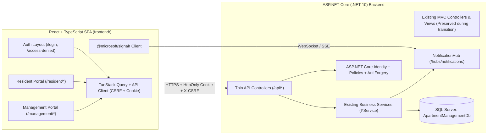

# APARTMENT-07A — REACT FRONTEND REDESIGN & MIGRATION AUDIT (PHASE 0)

> **Trạng thái:** Phase 0 — Read-Only Architecture & UI Inventory Audit (Hoàn thành)
> **Ngày thực hiện:** 04/11/2026
> **Nhánh Git hiện tại:** `main` (`clean working tree`, không có thay đổi mã nguồn trong Phase 0)
> **Nguyên tắc cốt lõi:** Chuyển đổi toàn bộ lớp giao diện sang **React + TypeScript + Vite** (tách biệt trải nghiệm **Resident Portal** và **Management Portal**), giữ nguyên **ASP.NET Core (.NET 10)** làm backend, tái sử dụng 100% các `Service`, `Entity`, `ApplicationDbContext`, `ASP.NET Core Identity` (HttpOnly Cookie), `Roles`, `Authorization Policies`, `SignalR NotificationHub`, cơ chế `RowVersion` Optimistic Concurrency và toàn bộ quy tắc nghiệp vụ hiện có.

---

## 1. Kiến trúc Hiện tại (Current Architecture Audit)

### 1.1. Solution & Project Structure

Solution `ApartmentManagement.slnx` bao gồm 2 project chính:

| Project | Đường dẫn | Target Framework | Vai trò |
| :--- | :--- | :--- | :--- |
| `ApartmentManagement` | `ApartmentManagement/ApartmentManagement.csproj` | `net10.0` | Ứng dụng chính ASP.NET Core MVC + Razor Pages (Identity UI) + Web API + SignalR Hub |
| `ApartmentManagement.Tests` | `ApartmentManagement.Tests/ApartmentManagement.Tests.csproj` | `net10.0` | Bộ kiểm thử tự động (xUnit, EF Core InMemory & SQL Server Integration Tests, `WebApplicationFactory`) |

**Cấu trúc thư mục chính của `ApartmentManagement`:**
- `Areas/Identity/Pages/Account/`: 36 file Razor Pages phục vụ đăng nhập (`Login`), đăng xuất (`Logout`), từ chối truy cập (`AccessDenied`), khóa tài khoản (`Lockout`), và quản lý tài khoản cá nhân (`Manage/Index`, `Manage/ChangePassword`, v.v.).
- `Common/`:
  - `Security/AppRoles.cs`: Định nghĩa hằng số cho 5 Roles (`AppRoles`) và 6 Authorization Policies (`AppPolicies`).
  - `Validation/`: Các custom validation attributes và hằng số kiểm tra dữ liệu (`ResidentValidation`, `ValidDateOfBirthAttribute`, v.v.).
- `Controllers/`: **30 Controllers** (bao gồm 26 MVC Controllers trả về `ViewResult` — một số có kèm action trả về JSON/File — và 4 `[ApiController]` thuần JSON).
- `Data/`:
  - `ApplicationDbContext.cs`: Kế thừa `IdentityDbContext<ApplicationUser>`, quản lý 22 `DbSet` nghiệp vụ cùng các bảng Identity.
  - `IdentityDataSeeder.cs`: Khởi tạo Roles, tài khoản mặc định và dữ liệu mẫu (`DevelopmentSampleVehicle`).
- `Hubs/`:
  - `NotificationHub.cs`: SignalR Hub tại endpoint `/hubs/notifications` yêu cầu `[Authorize]`.
- `Migrations/`: **20 bản ghi migration** (tất cả 20/20 đã được áp dụng đồng bộ trên `ApartmentManagementDb`).
- `Models/`: **46 file** định nghĩa thực thể EF Core, Enums trạng thái và một số ViewModel/DTO gắn liền với domain.
- `Services/`: **46 file** chứa các interface (`I*Service`) và lớp thực thi nghiệp vụ (`*Service`), được đăng ký `Scoped` (hoặc `Singleton` cho `IVietQrCodeGenerator`) trong `Program.cs`.
- `ViewModels/`: **9 file** ViewModel chuyên biệt cho Dashboard, Phản ánh, Sửa chữa, Phương tiện, Sự cố kỹ thuật và Báo cáo.
- `Views/`: **92 file `.cshtml`** (chia theo thư mục từng Controller và `Views/Shared/_Layout.cshtml`).
- `wwwroot/`: Chứa tài nguyên tĩnh (`css/site.css`, `js/site.js` xử lý Global Search & SignalR Notification Bell, thư viện Bootstrap 5, jQuery, SignalR client).

### 1.2. ASP.NET Core Version, Packages & Target Framework

- **Target Framework:** `.NET 10.0` (`net10.0`), `Nullable: enable`, `ImplicitUsings: enable`.
- **Các NuGet Packages chính trong `ApartmentManagement.csproj`:**
  - `Microsoft.AspNetCore.Identity.EntityFrameworkCore` (`10.0.5`)
  - `Microsoft.AspNetCore.Identity.UI` (`10.0.5`)
  - `Microsoft.EntityFrameworkCore.SqlServer` (`10.0.12`)
  - `Microsoft.EntityFrameworkCore.Sqlite` (`10.0.5`)
  - `Microsoft.EntityFrameworkCore.Tools` (`10.0.12`)
  - `QRCoder` (`1.6.0`) — dùng trong `VietQrCodeGenerator` để sinh ảnh QR PNG cho giao dịch thanh toán hóa đơn.

### 1.3. Services & Interfaces Nghiệp vụ Hiện có

Tất cả logic nghiệp vụ cốt lõi đều đã được tách vào tầng Service trong `ApartmentManagement/Services/` và đăng ký Dependency Injection tại `Program.cs`:

| Interface | Implementation | Trách nhiệm Nghiệp vụ Chính |
| :--- | :--- | :--- |
| `ICurrentUserService` | `CurrentUserService` | Truy xuất `UserId`, `UserName` và kiểm tra Role của người dùng hiện tại từ `IHttpContextAccessor`. |
| `IBuildingService` | `BuildingService` | CRUD Tòa nhà (`Building`), kiểm tra trùng `BuildingCode`, chặn xóa khi tòa nhà đã có căn hộ. |
| `IApartmentService` | `ApartmentService` | CRUD Căn hộ (`Apartment`), vô hiệu hóa (`Deactivate`), đồng bộ số căn hộ tòa nhà, kiểm tra lịch sử cư trú/hợp đồng/hóa đơn trước khi xóa. |
| `IResidentService` | `ResidentService` | Quản lý hồ sơ cư dân (`Resident`), cấp tài khoản `ApplicationUser` + gán Role `Resident`, kiểm tra trùng Email/CCCD, lấy danh sách căn hộ đang ở của cư dân. |
| `IOccupancyService` | `OccupancyService` | Quản lý cư trú (`ApartmentResident`): Chuyển vào (`MoveInAsync`), Chuyển đi (`MoveOutAsync`), cập nhật quan hệ/chủ hộ (`UpdateOccupancyAsync`), đảm bảo mỗi căn hộ chỉ có tối đa 1 chủ hộ active và tự động đồng bộ `Apartment.Status` (`Occupied` / `Available`). |
| `IContractService` | `ContractService` | Quản lý vòng đời Hợp đồng (`ApartmentContract`): Tạo bản nháp (`CreateDraftAsync`), sửa bản nháp (`UpdateDraftAsync`), Kích hoạt (`ActivateAsync`), Hoàn tất (`CompleteAsync`), Chấm dứt (`TerminateAsync`), Hủy (`CancelAsync`), lưu lịch sử `ApartmentContractStatusHistory` và kiểm soát `RowVersion`. |
| `IBillingService` | `BillingService` | Quản lý biểu giá (`ServiceTariff`), ghi chỉ số điện/nước đơn lẻ hoặc hàng loạt (`UtilityReading`), phát hành hóa đơn đơn lẻ hoặc theo lô (`ApartmentInvoice`, `ApartmentInvoiceLine`), hủy hóa đơn (`VoidInvoiceAsync`). |
| `IPaymentService` | `PaymentService` | Tạo lượt thanh toán VietQR (`CreateResidentPaymentAttemptAsync`), xác nhận thanh toán (`ConfirmSimulatedPaymentAsync`), từ chối thanh toán (`RejectPaymentAsync`), tự động đóng các giao dịch `Pending` còn lại khi hóa đơn đã thu đủ hoặc bị `Void`, kiểm soát `RowVersion` chống thanh toán trùng. |
| `IVietQrCodeGenerator` | `VietQrCodeGenerator` | Sinh chuỗi EMVCo VietQR và render ảnh PNG (`byte[]`) theo cấu hình `VietQrOptions` (`BankBin`, `AccountNumber`, `AccountName`). |
| `IFinancialReportService` | `FinancialReportService` | Tổng hợp báo cáo sao kê tài chính tháng (`GenerateMonthlyStatementAsync`) tuân thủ nghiêm ngặt quy tắc tiền tệ và xuất file CSV UTF-8 BOM (`ExportMonthlyStatementToCsv`). |
| `IRepairRequestService` | `RepairRequestService` | Vòng đời Yêu cầu sửa chữa của cư dân (`RepairRequest`): tạo yêu cầu, BQL phân công KTV (`RepairAssignment`), KTV bắt đầu xử lý (`StartProgressAsync`), KTV hoàn tất kèm vật tư/chi phí (`CompleteWorkAsync`), cư dân nghiệm thu/đánh giá (`ConfirmCompletionAsync`) hoặc yêu cầu làm lại (`RequestRedoAsync`), hủy yêu cầu (`CancelRequestAsync`). |
| `ITechnicalIncidentService` | `TechnicalIncidentService` | Quản lý Sự cố kỹ thuật tòa nhà (`TechnicalIncident` - UC47..UC50): KTV/BQL báo cáo sự cố, BQL tiếp nhận (`AcknowledgeIncidentAsync`), phân công KTV (`AssignTechnicianAsync`), KTV bắt đầu làm (`StartWorkAsync`), KTV báo cáo hoàn tất (`ResolveIncidentAsync`), BQL nghiệm thu đóng sự cố (`CloseIncidentAsync`). |
| `IVehicleService` | `VehicleService` | Cư dân đăng ký xe (`RegisterVehicleAsync`), hủy đơn (`CancelRegistrationAsync`), BQL duyệt xe & cấp thẻ (`ApproveVehicleAsync`), từ chối (`RejectVehicleAsync`), khóa/báo mất thẻ (`ReportLostOrLockCardAsync`), cấp đổi thẻ (`IssueOrReplaceCardAsync`), ngừng sử dụng xe (`DecommissionVehicleAsync`). |
| `IVisitorService` | `VisitorService` | Cư dân đăng ký khách thăm (`RegisterVisitorAsync` — kiểm tra căn hộ đang cư trú của cư dân), lễ tân/BQL `CheckInVisitorAsync`, `CheckOutVisitorAsync`, hủy lịch khách (`CancelVisitorPassAsync`). |
| `IAmenityService` | `AmenityService` | Quản lý danh mục tiện ích (`Amenity`), cư dân đặt lịch (`BookAmenityAsync`), kiểm tra khung giờ trống (`GetBookedSlotsAsync`), BQL duyệt/từ chối/hủy lịch (`ApproveBookingAsync`, `RejectBookingAsync`, `CancelBookingAsync`). |
| `IComplaintService` | `ComplaintService` | Cư dân gửi/sửa/hủy/đánh giá phản ánh (`Complaint`), BQL tiếp nhận & phản hồi (`ProcessComplaintAsync`), chuyển đổi phản ánh sang Yêu cầu sửa chữa (`ConvertToRepairRequestAsync`). |
| `IAnnouncementService` | `AnnouncementService` | Quản lý bản tin chung cư (`Announcement`), lọc theo tòa nhà và đối tượng nhận. |
| `INotificationService` | `NotificationService` | Tạo thông báo (`Notification`), đẩy realtime qua `IHubContext<NotificationHub>` (`ReceiveNotification`), truy vấn danh sách phân trang, đếm chưa đọc, đánh dấu đã đọc và xóa thông báo. |
| `ISearchService` | `SearchService` | Tìm kiếm toàn cục (`GlobalSearchResponseDto`) phân quyền theo Role: cư dân chỉ tìm thấy dữ liệu của chính mình; BQL tìm kiếm xuyên suốt Căn hộ, Cư dân, Hóa đơn, Sửa chữa, Phương tiện, Phản ánh. |
| `IUserAccountService` | `UserAccountService` | Quản trị tài khoản hệ thống (`SuperAdmin`): liệt kê, xem chi tiết, khóa/mở khóa (`SetActiveAsync`), đặt lại mật khẩu (`ResetPasswordAsync`), đổi Role (`ChangeRoleAsync`). |

### 1.4. Entity Framework Core, `ApplicationDbContext` & Migrations

- `ApplicationDbContext` quản lý **22 DbSet nghiệp vụ**:
  1. `Buildings` (`Building`)
  2. `Apartments` (`Apartment`)
  3. `Residents` (`Resident`)
  4. `ApartmentResidents` (`ApartmentResident`)
  5. `ApartmentContracts` (`ApartmentContract`)
  6. `ApartmentContractParties` (`ApartmentContractParty`)
  7. `ApartmentContractStatusHistory` (`ApartmentContractStatusHistory`)
  8. `ServiceTariffs` (`ServiceTariff`)
  9. `UtilityReadings` (`UtilityReading`)
  10. `ApartmentInvoices` (`ApartmentInvoice`)
  11. `ApartmentInvoiceLines` (`ApartmentInvoiceLine`)
  12. `PaymentTransactions` (`PaymentTransaction`)
  13. `RepairRequests` (`RepairRequest`)
  14. `RepairAssignments` (`RepairAssignment`)
  15. `RepairStatusHistories` (`RepairStatusHistory`)
  16. `Vehicles` (`Vehicle`)
  17. `ParkingCards` (`ParkingCard`)
  18. `VisitorPasses` (`VisitorPass`)
  19. `Amenities` (`Amenity`)
  20. `AmenityBookings` (`AmenityBooking`)
  21. `Complaints` (`Complaint`)
  22. `Announcements` (`Announcement`)
  23. `TechnicalIncidents` (`TechnicalIncident`)
  24. `Notifications` (`Notification`)
- **Concurrency Tokens (`RowVersion`):** Được cấu hình trên `ApartmentContract`, `ApartmentInvoice`, `PaymentTransaction`, `RepairRequest`, và `TechnicalIncident`. Hỗ trợ cả SQL Server (`rowversion` 8-byte tự động) và SQLite/InMemory trong test (`UpdateSqliteRowVersions()`).

### 1.5. ASP.NET Core Identity, Cookie Authentication, Roles & Policies

1. **Cấu hình Identity & Cookie (`Program.cs`):**
   - `SignIn.RequireConfirmedAccount = false`, `User.RequireUniqueEmail = true`.
   - Password Policy: tối thiểu 8 ký tự, yêu cầu chữ hoa, chữ thường, chữ số và ký tự đặc biệt.
   - Lockout Policy: khóa 15 phút sau 5 lần đăng nhập sai liên tiếp.
   - `SecurityStampValidatorOptions.ValidationInterval = TimeSpan.Zero`: Kiểm tra `SecurityStamp` trên mỗi request, đảm bảo khi `SuperAdmin` khóa tài khoản hoặc đổi Role thì phiên đăng nhập bị thu hồi ngay lập tức.
   - **Cookie Settings:**
     - `HttpOnly = true`
     - `SameSite = SameSiteMode.Strict`
     - `SecurePolicy = CookieSecurePolicy.Always`
     - `ExpireTimeSpan = TimeSpan.FromHours(4)`, `SlidingExpiration = true`
     - **Đã tích hợp sẵn xử lý `/api`:** Trong `OnRedirectToLogin` và `OnRedirectToAccessDenied`, nếu `context.Request.Path.StartsWithSegments("/api")`, hệ thống trả thẳng HTTP `401 Unauthorized` hoặc `403 Forbidden` thay vì redirect 302 về HTML login page.

2. **5 Roles Hệ thống (`AppRoles.cs`):**
   - `SuperAdmin`
   - `BuildingManager`
   - `Accountant`
   - `Technician`
   - `Resident`
   *(Lưu ý: Một số Controller cũ như `ComplaintController` và `VehicleController` có ghi thêm chuỗi role `"SystemAdmin,Manager"` bên cạnh `"SuperAdmin,BuildingManager"`, cần bảo toàn logic phân quyền dựa trên `AppRoles` và `AppPolicies`).*

3. **6 Authorization Policies (`AppPolicies` trong `Program.cs`):**
   - `FallbackPolicy`: Mặc định mọi endpoint đều yêu cầu đăng nhập (`RequireAuthenticatedUser()`).
   - `RequireSuperAdmin`: Chỉ `SuperAdmin`.
   - `RequireManagement`: `SuperAdmin`, `BuildingManager`.
   - `RequireAccountantOrManager`: `SuperAdmin`, `BuildingManager`, `Accountant`.
   - `RequireResident`: Chỉ `Resident`.
   - `RequireTechnician`: Chỉ `Technician`.
   - `RequireTechnicianOrManagement`: `SuperAdmin`, `BuildingManager`, `Technician`.

### 1.6. SignalR Notification Hub, File Download & CSV Export

- **SignalR Hub:** `NotificationHub` map tại `/hubs/notifications` với `[Authorize]`. Khi `NotificationService` tạo thông báo, server gửi sự kiện `"ReceiveNotification"` tới `Clients.User(userId)` kèm payload `{ id, title, content, type, isRead, targetUrl, createdAtUtc, displayDate }`.
- **Sinh và tải ảnh QR PNG:**
  - Management: `GET /Billing/PaymentQr/{id}`
  - Resident: `GET /MyInvoices/PaymentQr/{id}`
  - Trả về `File(pngBytes, "image/png")` với header `Cache-Control: no-store`.
- **Xuất báo cáo CSV:**
  - `GET /Billing/ExportMonthlyStatement`
  - `GET /Reports/ExportCsv`
  - Trả về `File(csvBytes, "text/csv; charset=utf-8", fileName)` có UTF-8 BOM để mở trực tiếp trên Excel không lỗi font tiếng Việt.
- **Upload file:** Hiện tại các luồng nghiệp vụ chưa bắt buộc lưu trữ file đính kèm nhị phân lên ổ đĩa trong database schema hiện hành.

### 1.7. Các API Endpoints Hiện có (Existing JSON / File Endpoints)

Hệ thống đã có sẵn một số `[ApiController]` và JSON action:

| Endpoint | HTTP Method | Controller | Auth Policy / Roles | Mục đích |
| :--- | :--- | :--- | :--- | :--- |
| `/api/apartmentresidents` | `GET` | `ApartmentResidentsController` | `SuperAdmin,BuildingManager,Resident` | Lấy danh sách cư trú (Resident chỉ thấy của mình) |
| `/api/apartmentresidents` | `POST` | `ApartmentResidentsController` | `RequireManagement` | Thủ tục Move-In qua JSON API |
| `/api/apartmentresidents/{id}/move-out` | `POST` | `ApartmentResidentsController` | `RequireManagement` | Thủ tục Move-Out qua JSON API |
| `/api/residents` | `GET` | `ResidentsApiController` | `RequireManagement` | Danh sách cư dân (có `searchTerm`) |
| `/api/residents/{id}` | `GET` | `ResidentsApiController` | `SuperAdmin,BuildingManager,Resident (self)` | Chi tiết cư dân kèm danh sách căn hộ |
| `/api/residents` | `POST` | `ResidentsApiController` | `RequireManagement` + `[ValidateAntiForgeryToken]` | Tạo mới cư dân + tài khoản |
| `/api/vehicles` | `GET` | `VehiclesController` | `SuperAdmin,BuildingManager,Resident` | Danh sách phương tiện (tự lọc theo Resident nếu là cư dân) |
| `/api/vehicles/{id}` | `GET` | `VehiclesController` | `SuperAdmin,BuildingManager,Resident` | Chi tiết phương tiện |
| `/api/vehicles` | `POST` | `VehiclesController` | `RequireResident` | Cư dân đăng ký phương tiện mới |
| `/api/parking-cards` | `GET` | `ParkingCardsController` | `SuperAdmin,BuildingManager,Resident` | Danh sách thẻ gửi xe |
| `/api/parking-cards/{id}` | `GET` | `ParkingCardsController` | `SuperAdmin,BuildingManager,Resident` | Chi tiết thẻ gửi xe |
| `/api/parking-cards` | `POST` | `ParkingCardsController` | `RequireManagement` | Cấp thẻ gửi xe mới |
| `/api/search?q=...` | `GET` | `SearchController` | `[Authorize]` | Tìm kiếm toàn cục theo Role |
| `/api/notifications/recent` | `GET` | `NotificationsController` | `[Authorize]` | Lấy 6 thông báo mới nhất + `unreadCount` |
| `/api/notifications/unread-count` | `GET` | `NotificationsController` | `[Authorize]` | Lấy số lượng thông báo chưa đọc |
| `/api/notifications/mark-read/{id}` | `POST` | `NotificationsController` | `[Authorize]` + `[ValidateAntiForgeryToken]` | Đánh dấu 1 thông báo đã đọc |
| `/api/notifications/mark-all-read` | `POST` | `NotificationsController` | `[Authorize]` + `[ValidateAntiForgeryToken]` | Đánh dấu tất cả thông báo đã đọc |
| `/api/announcements/recent` | `GET` | `AnnouncementsController` | `[Authorize]` | Lấy tối đa 20 bản tin chung cư mới nhất |
| `/AmenityBooking/GetBookedSlots` | `GET` | `AmenityBookingController` | `[Authorize]` | Lấy danh sách khung giờ đã đặt của tiện ích theo ngày |
| `/Buildings/CheckCodeExists` | `GET` | `BuildingsController` | `RequireManagement` | Kiểm tra trùng mã tòa nhà |
| `/Apartments/CheckCodeExists` | `GET` | `ApartmentsController` | `RequireManagement` | Kiểm tra trùng mã căn hộ trong tòa nhà |

### 1.8. Cấu hình Môi trường & Hạ tầng Kiểm thử (Test Infrastructure)

- **Configuration (`appsettings.json` / `appsettings.Development.json`):**
  - `ConnectionStrings:DefaultConnection`: kết nối `localhost\SQLEXPRESS`, database `ApartmentManagementDb`.
  - `Payments:VietQr`: cấu hình `BankBin`, `AccountNumber`, `AccountName`.
  - `Seed:DevelopmentSampleVehicle:Enabled`: bật/tắt seed xe mẫu ở môi trường Development.
- **Test Infrastructure (`ApartmentManagement.Tests`):**
  - Tổng cộng **881 bài kiểm thử** (gồm Unit Tests, Controller/Service Integration Tests dùng SQLite/InMemory và **23 bài `[SqlServerFact]`** kiểm thử chuyên sâu Migration, Concurrency `RowVersion`, Unique Filtered Index trên SQL Server thật với prefix `ApartmentHubTests_`).

---

## 2. Kiến trúc Mục tiêu (Target React + ASP.NET Core Architecture)

### 2.1. Mô hình Tổng thể



### 2.2. Cấu trúc Thư mục Frontend Đề xuất (`d:\ApartmentManagement\frontend\`)

```text
frontend/
├── public/
├── src/
│   ├── app/
│   │   ├── router.tsx                 # Cấu hình React Router (Auth, Resident, Management routes)
│   │   ├── providers.tsx              # QueryClientProvider, AuthProvider, SignalRProvider, ToastProvider
│   │   └── App.tsx
│   ├── layouts/
│   │   ├── AuthLayout.tsx             # Split-screen / Card layout cho Login, AccessDenied, Lockout
│   │   ├── ResidentLayout.tsx         # Layout ấm áp, rõ ràng cho Cư dân (Top/Sidebar nav + Quick actions)
│   │   └── ManagementLayout.tsx       # Layout điều hành mật độ cao choSuperAdmin/Manager/Accountant/Technician
│   ├── features/
│   │   ├── auth/                      # Login, Logout, Session (/api/auth/me), ChangePassword, AccessDenied
│   │   ├── resident/
│   │   │   ├── dashboard/             # Tổng quan căn hộ, công nợ, hóa đơn mới nhất, dịch vụ gần đây
│   │   │   ├── invoices/              # Hóa đơn của tôi, chi tiết dòng phí, VietQR, lịch sử giao dịch
│   │   │   ├── contracts/             # Hợp đồng của tôi & lịch sử trạng thái
│   │   │   ├── repairs/               # Yêu cầu sửa chữa, tạo mới, nghiệm thu/đánh giá, yêu cầu làm lại
│   │   │   ├── vehicles/              # Phương tiện & thẻ xe của tôi, đăng ký xe, khóa thẻ khẩn cấp
│   │   │   ├── visitors/              # Đăng ký khách thăm & quản lý danh sách khách của hộ
│   │   │   ├── amenities/             # Đặt lịch tiện ích, xem khung giờ trống, hủy lịch
│   │   │   ├── complaints/            # Gửi phản ánh, chỉnh sửa, rút phản ánh, đánh giá kết quả
│   │   │   └── profile/               # Hồ sơ cư dân, thành viên hộ gia đình, đổi mật khẩu
│   │   ├── management/
│   │   │   ├── dashboard/             # Management Dashboard (SuperAdmin/Manager/Accountant) & Technician Dashboard
│   │   │   ├── buildings/             # Quản lý tòa nhà (CRUD, kiểm tra mã)
│   │   │   ├── apartments/            # Quản lý căn hộ (CRUD, lọc theo tòa/trạng thái, ngừng sử dụng)
│   │   │   ├── residents/             # Quản lý hồ sơ cư dân & cấp tài khoản
│   │   │   ├── occupancies/           # Quản lý cư trú (Move-in, Move-out, đổi chủ hộ/quan hệ)
│   │   │   ├── contracts/             # Quản lý hợp đồng (Draft, Activate, Complete, Terminate, Cancel)
│   │   │   ├── billing/               # Biểu giá, ghi chỉ số điện nước (đơn/lô), phát hành hóa đơn (đơn/lô), hủy hóa đơn
│   │   │   ├── payments/              # Đối soát giao dịch thanh toán, Confirm / Reject (RowVersion)
│   │   │   ├── repairs/               # Hàng đợi sửa chữa (RepairQueue), phân công KTV, KTV nhận việc & hoàn thành
│   │   │   ├── technical-incidents/   # Sự cố kỹ thuật tòa nhà (UC47-UC50: Tạo, Tiếp nhận, Phân công, Xử lý, Đóng)
│   │   │   ├── vehicles/              # Duyệt đăng ký xe, cấp thẻ, khóa thẻ, cấp đổi thẻ, ngừng sử dụng
│   │   │   ├── visitors/              # Kiểm soát khách ra/vào (Check-in, Check-out, Hủy)
│   │   │   ├── amenities/             # Quản lý danh mục tiện ích & Phê duyệt/Từ chối lịch đặt tiện ích
│   │   │   ├── complaints/            # Tiếp nhận/Xử lý phản ánh & Chuyển thành yêu cầu sửa chữa
│   │   │   ├── announcements/         # Quản lý bản tin chung cư
│   │   │   ├── reports/               # Báo cáo tài chính & vận hành, biểu đồ, xuất CSV
│   │   │   └── accounts/              # Quản trị tài khoản hệ thống (Chỉ SuperAdmin)
│   │   ├── notifications/             # Trung tâm thông báo & Chuông thông báo Realtime (SignalR)
│   │   └── search/                    # Command Palette / Global Search (Ctrl+K)
│   ├── components/
│   │   ├── ui/                        # Các thành phần cơ sở (Button, Dialog, Drawer, Table, Badge, Select, Tabs...)
│   │   ├── data-display/              # KPI Card, StatusBadge, CurrencyText, DateTimeText, EmptyState, ErrorState
│   │   └── feedback/                  # ConfirmDialog, ReasonModal, Toast, SkeletonLoader
│   ├── services/
│   │   ├── apiClient.ts               # Fetch/Axios wrapper cấu hình credentials: 'include' + CSRF token header
│   │   └── signalrClient.ts           # Quản lý kết nối /hubs/notifications
│   ├── hooks/                         # useAuth, usePermissions, useDebounce, usePagination
│   ├── types/                         # TypeScript interfaces/DTOs đồng bộ 1:1 với Backend
│   └── utils/                         # Định dạng VND, ngày giờ Việt Nam, helper xử lý RowVersion & lỗi API
├── index.html
├── package.json
├── tsconfig.json
└── vite.config.ts
```

### 2.3. Phân chia Trách nhiệm Giữa Frontend và Backend

| Thành phần | Trách nhiệm của React Frontend | Trách nhiệm của ASP.NET Core Backend |
| :--- | :--- | :--- |
| **Giao diện & Điều hướng** | Render toàn bộ UI (Auth, Resident Portal, Management Portal), quản lý client routing (`react-router-dom`), trạng thái bộ lọc trên URL (`searchParams`), modal/drawer và thông báo toast. | Phục vụ SPA (hoặc proxy trong môi trường dev), giữ nguyên MVC Views hiện có cho tới khi nghiệm thu xong từng module. |
| **Xác thực & Phân quyền** | Gọi `/api/auth/me` khi khởi động để lấy thông tin User, Roles, ResidentId/Apartment; ẩn/hiện menu và route thông qua `<ProtectedRoute>` (chỉ mang tính chất UX). | Thực thi bảo mật thật sự bằng ASP.NET Core Identity Cookie (`HttpOnly`, `SameSite=Strict`) và `[Authorize(Policy = ...)]` trên mọi API endpoint. |
| **Nghiệp vụ & Tính toán** | Hiển thị chính xác số liệu từ API trả về; thực hiện client-side validation bằng `Zod` + `React Hook Form` để phản hồi nhanh cho người dùng. | Thực thi 100% quy tắc nghiệp vụ trong các `Service` hiện có (tính tiền điện/nước lũy tiến, công nợ, trạng thái hóa đơn, quy tắc chủ hộ, kiểm tra trùng lịch tiện ích). |
| **Kiểm soát Đồng thời** | Lưu giữ `rowVersion` (chuỗi Base64) nhận từ API chi tiết và gửi kèm khi gọi các API cập nhật/duyệt/xác nhận; hiển thị thông báo rõ ràng nếu nhận HTTP `409 Conflict`. | Giải mã `RowVersion`, kiểm tra `DbUpdateConcurrencyException` trong EF Core để chống ghi đè hoặc duyệt trùng giao dịch. |
| **Realtime & Xuất File** | Kết nối SignalR `/hubs/notifications`, cập nhật badge/toast tức thời; kích hoạt tải ảnh QR PNG và file báo cáo CSV. | Phát sự kiện SignalR từ `NotificationService`, render ảnh PNG từ `IVietQrCodeGenerator` và xuất mảng byte CSV từ `IFinancialReportService`. |

---

## 3. Kiểm kê Đầy đủ Giao diện Hiện tại (Complete UI Inventory)

### 3.1. Nhóm Màn hình Authentication & Tài khoản Cá nhân (`Areas/Identity` & `HomeController`)

| STT | Route / URL | Controller / Razor Page | View / File `.cshtml` | Role / Policy | Service / Data Source | Thao tác & Luồng liên quan |
| :--- | :--- | :--- | :--- | :--- | :--- | :--- |
| 1 | `/Identity/Account/Login` | `LoginModel` (Razor Page) | `Areas/Identity/Pages/Account/Login.cshtml` | `[AllowAnonymous]` | `SignInManager`, `UserManager` | Đăng nhập bằng Username hoặc Email + Password; kiểm tra `user.IsActive`; tự động điều hướng về `/Dashboard` (Management) hoặc `/Dashboard/Resident` (Resident) hoặc `/Dashboard/Technician` (nếu qua menu). |
| 2 | `/Identity/Account/Logout` | `LogoutModel` (Razor Page) | `Areas/Identity/Pages/Account/Logout.cshtml` | `[Authorize]` | `SignInManager` | Đăng xuất (`POST`), xóa cookie xác thực. |
| 3 | `/Identity/Account/AccessDenied` | `AccessDeniedModel` | `Areas/Identity/Pages/Account/AccessDenied.cshtml` | `[AllowAnonymous]` | N/A | Hiển thị thông báo không đủ quyền truy cập (`403`). |
| 4 | `/Identity/Account/Lockout` | `LockoutModel` | `Areas/Identity/Pages/Account/Lockout.cshtml` | `[AllowAnonymous]` | N/A | Hiển thị thông báo tài khoản bị khóa tạm thời do nhập sai mật khẩu quá số lần quy định. |
| 5 | `/Identity/Account/Manage` | `Manage/IndexModel` | `Areas/Identity/Pages/Account/Manage/Index.cshtml` | `[Authorize]` | `UserManager`, `SignInManager` | Xem Username và cập nhật số điện thoại tài khoản. |
| 6 | `/Identity/Account/Manage/ChangePassword` | `Manage/ChangePasswordModel` | `Areas/Identity/Pages/Account/Manage/ChangePassword.cshtml` | `[Authorize]` | `UserManager`, `SignInManager` | Đổi mật khẩu hiện tại sang mật khẩu mới. |
| 7 | `/` hoặc `/Home/Index` | `HomeController.Index` | `Views/Home/Index.cshtml` | `[AllowAnonymous]` | N/A | Trang chào mừng / Landing page chung cư. |
| 8 | `/Home/Privacy` | `HomeController.Privacy` | `Views/Home/Privacy.cshtml` | `[AllowAnonymous]` | N/A | Trang chính sách bảo mật. |
| 9 | `/Home/Error` | `HomeController.Error` | `Views/Shared/Error.cshtml` | `[AllowAnonymous]` | `Activity.Current` | Trang thông báo lỗi hệ thống chung. |

*(Ghi chú: Trong `Areas/Identity/Pages/Account/` còn có các trang scaffold mặc định của Identity UI như `Register`, `ForgotPassword`, `ResetPassword`, `ConfirmEmail`, `LoginWith2fa`, `ExternalLogin`, `Manage/TwoFactorAuthentication`, `Manage/PersonalData`, v.v. Tuy nhiên theo nghiệp vụ dự án hiện tại, tài khoản cư dân do BQL cấp qua `ResidentService` và tài khoản nội bộ do `SuperAdmin` quản lý).*

---

### 3.2. Nhóm Màn hình Resident Portal (Dành cho Cư dân — `AppRoles.Resident`)

| STT | Route / URL | Controller & Action | View (`.cshtml`) | Role / Policy | Service / Data Source | Thao tác CRUD, Validation & Trạng thái UI |
| :--- | :--- | :--- | :--- | :--- | :--- | :--- |
| 1 | `/Dashboard/Resident` | `DashboardController.Resident` | `Views/Dashboard/Resident.cshtml` | `RequireResident` | `ApplicationDbContext`, `UserManager`, `INotificationService` | **Read:** Tổng quan căn hộ đang ở, danh sách thành viên hộ gia đình, hóa đơn mới nhất (Tổng tiền, Đã trả Confirmed, Còn nợ), tổng dư nợ tất cả hóa đơn Issued, 5 yêu cầu sửa chữa gần nhất, danh sách xe & thẻ xe, 5 khách thăm gần nhất, 5 thông báo mới nhất. |
| 2 | `/Dashboard/EditProfile` | `DashboardController.EditProfile` (`GET`, `POST`) | `Views/Dashboard/EditProfile.cshtml` | `RequireResident` | `ApplicationDbContext`, `UserManager` | **Read/Update:** Xem Họ tên, Email, CCCD (readonly); cập nhật Ngày sinh (`ValidDateOfBirth`), Giới tính, Địa chỉ thường trú, Liên hệ khẩn cấp (`ResidentValidation`). |
| 3 | `/MyInvoices` | `MyInvoicesController.Index` | `Views/MyInvoices/Index.cshtml` | `RequireResident` | `IBillingService` (`GetResidentInvoicesAsync`) | **Read:** Danh sách hóa đơn của căn hộ cư dân đang ở, hiển thị kỳ thu phí, tổng tiền, số tiền đã thanh toán (`Confirmed`), số tiền còn lại, trạng thái hóa đơn. |
| 4 | `/MyInvoices/Details/{id}` | `MyInvoicesController.Details` (`GET`), `CreateSimulatedPayment` (`POST`), `PaymentQr` (`GET`) | `Views/MyInvoices/Details.cshtml` | `RequireResident` | `IBillingService`, `IPaymentService`, `IVietQrCodeGenerator` | **Read/Create:** Xem chi tiết các dòng phí (`ApartmentInvoiceLine`), lịch sử giao dịch thanh toán, tạo lượt thanh toán VietQR mới (`CreateResidentPaymentAttemptAsync`), hiển thị mã QR PNG (`/MyInvoices/PaymentQr/{id}`) và thông tin chuyển khoản ngân hàng. |
| 5 | `/MyInvoices/TransactionDetails/{id}` | `MyInvoicesController.TransactionDetails` | `Views/MyInvoices/TransactionDetails.cshtml` | `RequireResident` | `IPaymentService`, `IBillingService` | **Read:** Xem chi tiết một giao dịch thanh toán (`PaymentTransaction`), mã tham chiếu `Reference`, trạng thái (`Pending`/`Confirmed`/`Rejected`), lý do từ chối (bao gồm nhận diện auto-closed rejection) và mã QR nếu đang `Pending`. |
| 6 | `/MyContracts` | `MyContractsController.Index` | `Views/MyContracts/Index.cshtml` | `RequireResident` | `IContractService` (`GetForResidentUserAsync`) | **Read:** Danh sách hợp đồng mà cư dân là một bên tham gia (`Lessor` hoặc `Lessee`). |
| 7 | `/MyContracts/Details/{id}` | `MyContractsController.Details` | `Views/MyContracts/Details.cshtml` | `RequireResident` | `IContractService` | **Read:** Chi tiết hợp đồng, các bên tham gia, tiền thuê, tiền cọc và lịch sử thay đổi trạng thái hợp đồng. |
| 8 | `/RepairRequests` (alias `/MyIncidents`) | `RepairRequestsController.Index` | `Views/RepairRequests/Index.cshtml` | `RequireResident` | `IRepairRequestService`, `IResidentService` | **Read:** Danh sách các yêu cầu sửa chữa của cư dân. |
| 9 | `/RepairRequests/Create` | `RepairRequestsController.Create` (`GET`, `POST`) | `Views/RepairRequests/Create.cshtml` | `RequireResident` | `IRepairRequestService` | **Create:** Tạo yêu cầu sửa chữa cho căn hộ đang cư trú (Chọn căn hộ, Tiêu đề, Mô tả, Mức độ ưu tiên `Low`/`Normal`/`High`/`Urgent`). Chặn nếu cư dân chưa có căn hộ đang cư trú. |
| 10 | `/RepairRequests/Details/{id}` | `RepairRequestsController.Details` + `Cancel`, `Confirm`, `RequestRedo` (`POST`) | `Views/RepairRequests/Details.cshtml` | `RequireResident` | `IRepairRequestService` | **Read/Update:** Xem chi tiết tiến độ, lịch sử phân công KTV, kết quả xử lý & chi phí vật tư; **Hủy yêu cầu** (`Cancel`), **Nghiệm thu & Đánh giá 1–5 sao** (`Confirm` khi `PendingConfirmation`), hoặc **Yêu cầu xử lý lại** (`RequestRedo` kèm lý do). Có kiểm tra `RowVersion`. |
| 11 | `/AmenityBooking` | `AmenityBookingController.Index` | `Views/AmenityBooking/Index.cshtml` | `[Authorize]` (Dùng cho Cư dân) | `IAmenityService` | **Read:** Danh mục tiện ích đang hoạt động (Hồ bơi, Phòng Gym, BBQ, Phòng sinh hoạt...), giờ mở/đóng cửa, sức chứa, phí sử dụng. |
| 12 | `/AmenityBooking/Create/{id}` | `AmenityBookingController.Create` (`GET`, `POST`) + `GetBookedSlots` (`GET`) | `Views/AmenityBooking/Create.cshtml` | `[Authorize]` | `IAmenityService` | **Create:** Đặt lịch sử dụng tiện ích theo ngày, giờ bắt đầu, giờ kết thúc, số lượng khách, ghi chú; gọi AJAX `/AmenityBooking/GetBookedSlots` để xem các ca đã có người đặt trong ngày. |
| 13 | `/AmenityBooking/MyBookings` | `AmenityBookingController.MyBookings` (`GET`) + `Cancel` (`POST`) | `Views/AmenityBooking/MyBookings.cshtml` | `[Authorize]` | `IAmenityService` | **Read/Update:** Xem lịch sử đặt tiện ích của cư dân và hủy lịch đặt (`Cancel`) khi chưa diễn ra. |
| 14 | `/MyAmenities` & `/MyAmenities/Book/{id}` | `MyAmenitiesController.Index`, `Book`, `Cancel` | `Views/MyAmenities/Index.cshtml`, `Book.cshtml` | `RequireResident` | `IAmenityService` | **Read/Create/Update (Legacy/Trùng lặp với `AmenityBooking`):** Cùng gọi `IAmenityService` để xem tiện ích, đặt lịch và hủy lịch của cư dân. Sẽ được hợp nhất vào luồng `/resident/amenities` trên React. |
| 15 | `/Vehicle` (khi đăng nhập là Resident) | `VehicleController.Index`, `Details`, `Register` (`GET`/`POST`), `Cancel` (`POST`), `LockCard` (`POST`) | `Views/Vehicle/Index.cshtml`, `Details.cshtml`, `Register.cshtml` | `Resident` (chung Controller với Management) | `IVehicleService` | **Read/Create/Update:** Cư dân xem danh sách xe của mình, đăng ký xe mới (`Register`), hủy đơn khi đang `Chờ duyệt` (`Cancel`), và khóa thẻ xe khẩn cấp khi mất thẻ (`LockCard`). |
| 16 | `/Visitors` & `/Visitors/Register` (khi đăng nhập là Resident) | `VisitorsController.Index` (`GET`), `Register` (`GET`/`POST`), `Cancel` (`POST`) | `Views/Visitors/Index.cshtml`, `Register.cshtml` | `RequireResident` / `[Authorize]` | `IVisitorService`, `IResidentService` | **Read/Create/Update:** Cư dân xem danh sách khách đã đăng ký của mình, đăng ký khách thăm mới cho căn hộ đang ở (`Register`), hoặc hủy lịch hẹn khách (`Cancel`). |
| 17 | `/Complaint`, `/Complaint/Create`, `/Complaint/Edit/{id}`, `/Complaint/Details/{id}` (khi là Resident) | `ComplaintController.Index`, `Details`, `Create`, `Edit`, `Rate`, `Cancel` | `Views/Complaint/Index.cshtml`, `Details.cshtml`, `Create.cshtml`, `Edit.cshtml` | `Resident` (chung Controller với Management) | `IComplaintService`, `IResidentService` | **CRUD:** Cư dân gửi phản ánh mới (`Create`), sửa phản ánh khi còn ở trạng thái `Chờ tiếp nhận` (`Edit`), rút phản ánh (`Cancel`), và đánh giá 1–5 sao kèm nhận xét sau khi BQL đã xử lý (`Rate`). |

---

### 3.3. Nhóm Màn hình Management Portal (Ban Quản lý, Kế toán, Kỹ thuật viên, SuperAdmin)

| STT | Route / URL | Controller & Action | View (`.cshtml`) | Role / Policy | Service / Data Source | Thao tác CRUD, Validation & Trạng thái UI |
| :--- | :--- | :--- | :--- | :--- | :--- | :--- |
| 1 | `/Dashboard` (`/Dashboard/Index`) | `DashboardController.Index` | `Views/Dashboard/Index.cshtml` | `RequireManagement` (`SuperAdmin`, `BuildingManager`) | `ApplicationDbContext`, `UserManager` | **Read:** KPI tổng hợp toàn chung cư (Tòa nhà, Căn hộ đang ở/trống, Cư dân, Hóa đơn đã phát hành/đã thu/một phần/chưa thu, Tổng phát hành, Thực thu Confirmed, Công nợ, Biểu đồ xu hướng doanh thu 6 tháng, Sửa chữa khẩn cấp, Phương tiện chờ duyệt, Khách hôm nay/đang trong tòa, Phản ánh, Tòa nhà mới). |
| 2 | `/Dashboard/Technician` | `DashboardController.Technician` | `Views/Dashboard/Technician.cshtml` | `RequireTechnician` (`Technician`) | `ApplicationDbContext`, `UserManager` | **Read:** Bảng điều khiển riêng cho Kỹ thuật viên: Thống kê phiếu được giao (`Assigned`), đang làm (`InProgress`), chờ nghiệm thu (`PendingConfirmation`), đã hoàn thành (`Completed`), danh sách công việc ưu tiên cần xử lý ngay. |
| 3 | `/Buildings`, `/Buildings/Details/{id}`, `/Create`, `/Edit/{id}`, `/Delete/{id}` | `BuildingsController` (`Index`, `Details`, `Create`, `Edit`, `Delete`, `CheckCodeExists`) | `Views/Buildings/Index.cshtml`, `Details.cshtml`, `Create.cshtml`, `Edit.cshtml`, `Delete.cshtml` | `RequireManagement` | `IBuildingService` | **CRUD:** Quản lý danh sách tòa nhà, kiểm tra trùng mã `BuildingCode` realtime, xem danh sách căn hộ thuộc tòa nhà, chặn xóa nếu tòa nhà đang có căn hộ. |
| 4 | `/Apartments`, `/Apartments/Details/{id}`, `/Create`, `/Edit/{id}`, `/Delete/{id}` | `ApartmentsController` (`Index`, `Details`, `Create`, `Edit`, `Delete`, `Deactivate`, `CheckCodeExists`) | `Views/Apartments/Index.cshtml`, `Details.cshtml`, `Create.cshtml`, `Edit.cshtml`, `Delete.cshtml` | `RequireManagement` | `IApartmentService`, `IBuildingService` | **CRUD + Deactivate:** Lọc căn hộ theo tòa nhà, trạng thái (`Available`, `Occupied`, `Maintenance`, `Inactive`), từ khóa; tạo/sửa căn hộ; ngừng sử dụng (`Deactivate`) hoặc xóa căn hộ (chỉ khi chưa phát sinh dữ liệu liên kết). |
| 5 | `/Residents`, `/Residents/Details/{id}`, `/Create`, `/Edit/{id}`, `/Delete/{id}` | `ResidentsController` (`Index`, `Details`, `Create`, `Edit`, `Delete`) | `Views/Residents/Index.cshtml`, `Details.cshtml`, `Create.cshtml`, `Edit.cshtml`, `Delete.cshtml` | `RequireManagement` | `IResidentService` | **CRUD:** Tìm kiếm cư dân theo tên/email/CCCD/SĐT; tạo hồ sơ cư dân mới đồng thời cấp tài khoản `ApplicationUser` (Role `Resident`); cập nhật thông tin cá nhân; xóa hồ sơ (chỉ khi chưa có lịch sử cư trú/xe/hóa đơn). |
| 6 | `/Occupancies`, `/Occupancies/Details/{id}`, `/Create`, `/Edit/{id}`, `/MoveOut/{id}` | `OccupanciesController` (`Index`, `Details`, `Create`, `Edit`, `MoveOut`) | `Views/Occupancies/Index.cshtml`, `Details.cshtml`, `Create.cshtml`, `Edit.cshtml`, `MoveOut.cshtml` | `RequireManagement` | `IOccupancyService`, `IApartmentService`, `IResidentService` | **CRUD + Move-In/Move-Out:** Lọc cư trú (`active` / `history`, theo căn hộ, theo cư dân); thủ tục chuyển vào (`Create`), chỉnh sửa quan hệ/chủ hộ (`Edit`), thủ tục chuyển đi (`MoveOut`) tự động cập nhật trạng thái căn hộ. |
| 7 | `/Contracts`, `/Contracts/Details/{id}`, `/Create`, `/Edit/{id}` + `Activate`, `Complete`, `Terminate`, `Cancel` | `ContractsController` (`Index`, `Details`, `Create`, `Edit`, `Activate`, `Complete`, `Terminate`, `Cancel`) | `Views/Contracts/Index.cshtml`, `Details.cshtml`, `Edit.cshtml` | `RequireManagement` | `IContractService`, `ApplicationDbContext` | **CRUD + State Transitions (RowVersion):** Phân trang & lọc hợp đồng theo mã/căn hộ/cư dân/trạng thái; tạo & sửa hợp đồng nháp (`Draft`); kích hoạt (`Activate`), hoàn tất (`Complete`), chấm dứt trước hạn (`Terminate` - bắt buộc nhập lý do), hủy (`Cancel` - bắt buộc nhập lý do); xem lịch sử trạng thái. |
| 8 | `/Billing` (`/Billing/Index`) | `BillingController.Index` + `ExportMonthlyStatement` (`GET`), `CreateTariff`, `RecordReading`, `RecordBatchReadings`, `CreateInvoice`, `BatchCreateInvoices`, `BatchIssueInvoices` (`POST`) | `Views/Billing/Index.cshtml` | `RequireAccountantOrManager` (`SuperAdmin`, `BuildingManager`, `Accountant`) | `IBillingService`, `IPaymentService`, `IFinancialReportService` | **Read/Create/Batch Operations:** Màn hình điều hành thu phí trung tâm: (1) Bộ lọc kỳ/tòa nhà/trạng thái & xuất CSV sao kê tháng; (2) Cấu hình biểu giá dịch vụ (`ServiceTariff`); (3) Ghi chỉ số điện/nước đơn lẻ hoặc theo lô (`RecordBatchReadings`); (4) Tạo hóa đơn nháp/phát hành đơn lẻ hoặc theo lô cả tòa nhà (`BatchCreateInvoices`, `BatchIssueInvoices`). |
| 9 | `/Billing/Details/{id}` | `BillingController.Details` (`GET`) + `Issue`, `Void`, `CreatePaymentAttempt` (`POST`), `PaymentQr` (`GET`) | `Views/Billing/Details.cshtml` | `RequireAccountantOrManager` | `IBillingService`, `IPaymentService`, `IVietQrCodeGenerator` | **Read/Update (RowVersion):** Xem chi tiết hóa đơn, các dòng phí (`ApartmentInvoiceLine`), lịch sử giao dịch thanh toán; phát hành hóa đơn nháp (`Issue`), hủy hóa đơn (`Void`), tạo lượt thanh toán VietQR hỗ trợ cư dân và xem ảnh QR. |
| 10 | `/Billing/TariffDetails/{id}` | `BillingController.TariffDetails` (`GET`) + `CloseTariff` (`POST`) | `Views/Billing/TariffDetails.cshtml` | `RequireAccountantOrManager` | `IBillingService` | **Read/Update:** Xem chi tiết biểu giá dịch vụ (bao gồm các bậc lũy tiến điện/nước) và đóng hiệu lực biểu giá (`CloseTariff`). |
| 11 | `/Payments` (`/Payments/Index`) | `PaymentsController.Index` | `Views/Payments/Index.cshtml` | `RequireAccountantOrManager` | `IPaymentService` | **Read:** Danh sách giao dịch thanh toán toàn hệ thống, phân trang và lọc đa chiều (Trạng thái `Pending`/`Confirmed`/`Rejected`, từ khóa, mã tham chiếu `Reference`, mã căn hộ/tòa nhà, tên cư dân, khoảng thời gian `fromDate`–`toDate`), thẻ KPI tổng hợp. |
| 12 | `/Payments/Details/{id}` | `PaymentsController.Details` (`GET`) + `Confirm`, `Reject` (`POST`) | `Views/Payments/Details.cshtml` | `RequireAccountantOrManager` | `IPaymentService` | **Read/Update (RowVersion):** Xem chi tiết giao dịch thanh toán, đối chiếu với hóa đơn gốc và các giao dịch cùng hóa đơn; **Xác nhận đã thu tiền** (`Confirm` kèm `RowVersionToken`) hoặc **Từ chối giao dịch** (`Reject` kèm lý do bắt buộc ≤ 500 ký tự và `RowVersionToken`). |
| 13 | `/RepairQueue` (alias `/IncidentQueue`) | `RepairQueueController.Index` | `Views/RepairQueue/Index.cshtml` & `Views/RepairQueue/MyTasks.cshtml` | `RequireTechnicianOrManagement` (`SuperAdmin`, `BuildingManager`, `Technician`) | `IRepairRequestService` | **Read:** Hàng đợi yêu cầu sửa chữa. Tab `"all-requests"` (toàn bộ yêu cầu, lọc theo trạng thái/mức độ ưu tiên/từ khóa) và Tab `"my-tasks"` (danh sách việc được phân công riêng cho Kỹ thuật viên đang đăng nhập). |
| 14 | `/RepairQueue/Details/{id}` | `RepairQueueController.Details` + `StartWork` (`POST`) | `Views/RepairQueue/Details.cshtml` | `RequireTechnicianOrManagement` | `IRepairRequestService` | **Read/Update (RowVersion):** Xem chi tiết yêu cầu sửa chữa, lịch sử phân công và lịch sử trạng thái; KTV bấm **Bắt đầu xử lý** (`StartWork`). |
| 15 | `/RepairQueue/Assign/{id}` | `RepairQueueController.Assign` (`GET`, `POST`) | `Views/RepairQueue/Assign.cshtml` | `RequireManagement` | `IRepairRequestService` | **Update (RowVersion):** BQL chọn Kỹ thuật viên khả dụng, ngày hẹn xử lý (`ScheduledDate`) và ghi chú để phân công. |
| 16 | `/RepairQueue/CompleteWork/{assignmentId}` | `RepairQueueController.CompleteWork` (`GET`, `POST`) | `Views/RepairQueue/CompleteWork.cshtml` | `RequireTechnician` | `IRepairRequestService` | **Update (RowVersion):** KTV báo cáo hoàn thành công việc, nhập kết quả xử lý, vật tư/linh kiện thay thế (`SpareParts`), chi phí vật tư (`MaterialCost`) để chuyển sang trạng thái chờ cư dân nghiệm thu (`PendingConfirmation`). |
| 17 | `/TechnicalIncidents`, `/Details/{id}`, `/Create`, `/Assign/{id}`, `/Resolve/{id}` + `Acknowledge`, `StartWork`, `Close` | `TechnicalIncidentsController` | `Views/TechnicalIncidents/Index.cshtml`, `Details.cshtml`, `Create.cshtml`, `Assign.cshtml`, `Resolve.cshtml` | `RequireTechnicianOrManagement` (`Acknowledge`/`Assign`/`Close` yêu cầu `RequireManagement`; `StartWork`/`Resolve` yêu cầu `RequireTechnician`) | `ITechnicalIncidentService`, `IBuildingService` | **CRUD + Full Workflow (UC47–UC50, RowVersion):** (1) KTV/BQL tạo báo cáo sự cố hạ tầng tòa nhà (`Create`); (2) BQL tiếp nhận (`Acknowledge`); (3) BQL phân công KTV (`Assign`); (4) KTV bắt đầu làm (`StartWork`); (5) KTV báo cáo kết quả & chi phí (`Resolve`); (6) BQL nghiệm thu đóng sự cố (`Close`). |
| 18 | `/Vehicle` & `/Vehicle/Review/{id}` (khi là Management) | `VehicleController.Index`, `Details`, `Review` (`GET`), `Approve`, `Reject`, `LockCard`, `ReplaceCard`, `Decommission` (`POST`) | `Views/Vehicle/Index.cshtml`, `Details.cshtml`, `Review.cshtml` | `SuperAdmin,BuildingManager` | `IVehicleService` | **Read/Update:** Xem toàn bộ phương tiện, lọc theo trạng thái/biển số; xét duyệt xe & cấp mã thẻ bãi đỗ (`Approve`), từ chối (`Reject`), khóa thẻ (`LockCard`), cấp đổi thẻ mới (`ReplaceCard`), chuyển trạng thái ngừng sử dụng (`Decommission`). |
| 19 | `/Visitors` (khi là Management) | `VisitorsController.Index` + `CheckIn`, `CheckOut`, `Cancel` (`POST`) | `Views/Visitors/Index.cshtml` | `RequireManagement` (cho `CheckIn`/`CheckOut`) | `IVisitorService` | **Read/Update:** Lọc khách thăm theo ngày và trạng thái (`Đã đăng ký`, `Đã vào`, `Đã ra`, `Đã hủy`); thực hiện **Check-in** khi khách đến, **Check-out** khi khách rời tòa nhà, hoặc **Hủy** phiếu đăng ký. |
| 20 | `/AmenityManagement` & `/AmenityManagement/Amenities`, `/CreateAmenity`, `/EditAmenity/{id}` | `AmenityManagementController` (`Index`, `Approve`, `Reject`, `Cancel`, `Amenities`, `CreateAmenity`, `EditAmenity`, `DeleteAmenity`) | `Views/AmenityManagement/Index.cshtml`, `Amenities.cshtml`, `CreateAmenity.cshtml`, `EditAmenity.cshtml` | `RequireManagement` | `IAmenityService` | **CRUD + Booking Approval:** Quản lý danh sách đặt lịch tiện ích của toàn bộ cư dân (lọc theo ngày/trạng thái, Duyệt `Approve`, Từ chối `Reject` kèm lý do, Hủy `Cancel`); CRUD danh mục tiện ích (`Amenities`). |
| 21 | `/Amenities` & `/Amenities/Bookings`, `/Create`, `/Edit/{id}` | `AmenitiesController` (`Index`, `Create`, `Edit`, `Delete`, `Bookings`, `ApproveBooking`, `RejectBooking`, `CancelBooking`) | `Views/Amenities/Index.cshtml`, `Create.cshtml`, `Edit.cshtml`, `Bookings.cshtml` | `[Authorize]` (Actions quản lý kiểm tra Role `SuperAdmin`/`BuildingManager`) | `IAmenityService` | **CRUD (Legacy/Trùng lặp với `AmenityManagement`):** Cùng sử dụng `IAmenityService` để quản lý tiện ích và duyệt lịch đặt. Sẽ được hợp nhất vào `/management/amenities` trên React. |
| 22 | `/Complaint`, `/Complaint/Details/{id}`, `/Complaint/Process/{id}` (khi là Management) | `ComplaintController.Index`, `Details`, `Process` (`GET`/`POST`), `ConvertToRepairRequest` (`POST`) | `Views/Complaint/Index.cshtml`, `Details.cshtml`, `Process.cshtml` | `SuperAdmin,BuildingManager` | `IComplaintService` | **Read/Update:** Xem toàn bộ phản ánh cư dân (lọc theo trạng thái, danh mục, từ khóa); tiếp nhận và cập nhật trạng thái xử lý + ghi chú phản hồi (`Process`); hoặc **Chuyển tiếp thành Yêu cầu sửa chữa** (`ConvertToRepairRequest`). |
| 23 | `/Reports` (`/Reports/Index`) & `/Reports/ExportCsv` | `ReportsController.Index`, `ExportCsv` | `Views/Reports/Index.cshtml` | `RequireAccountantOrManager` | `IFinancialReportService`, `ApplicationDbContext` | **Read + CSV Export:** Báo cáo tổng hợp theo Tòa nhà / Năm / Tháng / Từ khóa: Bảng sao kê tài chính chi tiết từng căn hộ (Phát hành, Đã thu Confirmed, Công nợ), thống kê phân bổ Sửa chữa (theo trạng thái & độ ưu tiên), Phương tiện (theo loại xe & trạng thái), Khách thăm, Phản ánh; xuất file CSV. |
| 24 | `/Accounts` & `/Accounts/Details/{id}` | `AccountsController.Index`, `Details` + `SetActive`, `ResetPassword`, `ChangeRole` (`POST`) | `Views/Accounts/Index.cshtml`, `Details.cshtml` | `RequireSuperAdmin` (`SuperAdmin`) | `IUserAccountService` | **Read/Update:** Quản trị toàn bộ tài khoản người dùng trong hệ thống (lọc theo Role, trạng thái Active/Locked, từ khóa); khóa/mở khóa tài khoản (`SetActive`), đặt lại mật khẩu tạm thời (`ResetPassword`), thay đổi Role (`ChangeRole`). Có kiểm tra an toàn không làm mất `SuperAdmin` hoạt động cuối cùng. |

---

### 3.4. Nhóm Màn hình Dùng chung (Shared Screens & Components)

| STT | Route / Thành phần | Controller & Action | View (`.cshtml` / JS) | Role / Policy | Service / Data Source | Mô tả Chức năng |
| :--- | :--- | :--- | :--- | :--- | :--- | :--- |
| 1 | `/Announcements`, `/Announcements/Details/{id}`, `/Create` | `AnnouncementsController` (`Index`, `Details`, `Create`, `Delete`, `Recent`) | `Views/Announcements/Index.cshtml`, `Details.cshtml`, `Create.cshtml` | `[Authorize]` (`Create`/`Delete` yêu cầu `RequireManagement`) | `IAnnouncementService` | Xem danh sách bản tin chung cư và chi tiết bản tin (dùng chung cho mọi Role; riêng `SuperAdmin` và `BuildingManager` có quyền đăng bản tin mới theo Tòa nhà/Nhóm đối tượng và xóa bản tin). |
| 2 | `/Notifications` & `/Notifications/Details/{id}` | `NotificationsController` (`Index`, `Details`, `MarkAsRead`, `MarkAllAsRead`, `Delete`) | `Views/Notifications/Index.cshtml`, `Details.cshtml` | `[Authorize]` | `INotificationService` | Trung tâm thông báo cá nhân của người dùng (lọc tất cả / chưa đọc, phân trang, đánh dấu đã đọc từng tin hoặc tất cả, xóa thông báo, tự động điều hướng tới `TargetUrl`). |
| 3 | Header Global Search Dropdown | `SearchController.Search` (`/api/search?q=...`) | `_Layout.cshtml` + `wwwroot/js/site.js` | `[Authorize]` | `ISearchService` | Tìm kiếm nhanh toàn hệ thống có debounce 300ms, điều hướng bàn phím (`ArrowUp`/`ArrowDown`/`Enter`/`Escape`), kết quả nhóm theo danh mục và tự động giới hạn phạm vi dữ liệu theo Role của người dùng. |
| 4 | Header Notification Bell & Realtime Toast | `NotificationsController` (`/api/notifications/recent`, `mark-all-read`) + `NotificationHub` (`/hubs/notifications`) | `_Layout.cshtml` + `wwwroot/js/site.js` | `[Authorize]` | `INotificationService`, `NotificationHub` | Chuông thông báo trên thanh Header: hiển thị số lượng chưa đọc, danh sách 6–8 thông báo gần nhất, nút đánh dấu tất cả đã đọc và Toast thông báo tức thời qua SignalR khi có sự kiện nghiệp vụ mới. |

---

## 4. Bảng Mapping Đầy đủ MVC → React (Complete MVC-to-React Mapping Table)

Bảng dưới đây ánh xạ **toàn bộ 100% các Route/View MVC & Razor Pages hiện có** sang hệ thống Route của ứng dụng React SPA mà không bỏ sót bất kỳ màn hình nào:

| MVC Route / View Hiện tại | React Route Đề xuất | User Group | Required API Endpoints | Existing Service | Status |
| :--- | :--- | :--- | :--- | :--- | :--- |
| `/Identity/Account/Login` (`Login.cshtml`) | `/login` | Auth (Public) | `POST /api/auth/login`, `GET /api/auth/me` | `SignInManager`, `UserManager` | Cần tạo API Auth |
| `/Identity/Account/Logout` (`Logout.cshtml`) | N/A (Action nút Đăng xuất → `/login`) | Auth (All Authenticated) | `POST /api/auth/logout` | `SignInManager` | Cần tạo API Auth |
| `/Identity/Account/AccessDenied` (`AccessDenied.cshtml`) | `/access-denied` | Auth / Shared | N/A | N/A | Cần tạo trang React |
| `/Identity/Account/Lockout` (`Lockout.cshtml`) | `/lockout` | Auth (Public) | N/A | N/A | Cần tạo trang React |
| `/Identity/Account/Manage` (`Manage/Index.cshtml`) | `/resident/profile` & `/management/profile` | Resident & Management | `GET /api/auth/me`, `PUT /api/auth/profile` | `UserManager`, `IResidentService` | Cần tạo API Profile |
| `/Identity/Account/Manage/ChangePassword` (`ChangePassword.cshtml`) | `/resident/profile/password` & `/management/profile/password` | Resident & Management | `POST /api/auth/change-password` | `UserManager`, `SignInManager` | Cần tạo API Auth |
| `/`, `/Home/Index`, `/Home/Privacy` | `/` (Tự động điều hướng theo Role tới `/resident/dashboard` hoặc `/management/dashboard`, hoặc `/login`) | Shared | `GET /api/auth/me` | `ICurrentUserService` | Cần tạo Route Guard |
| `/Dashboard/Resident` (`Views/Dashboard/Resident.cshtml`) | `/resident/dashboard` | Resident Portal (`Resident`) | `GET /api/resident/dashboard` | `ApplicationDbContext`, `INotificationService` | Cần tạo API Dashboard |
| `/Dashboard/EditProfile` (`Views/Dashboard/EditProfile.cshtml`) | `/resident/profile` | Resident Portal (`Resident`) | `GET /api/resident/profile`, `PUT /api/resident/profile` | `ApplicationDbContext`, `UserManager` | Cần tạo API Profile |
| `/MyInvoices` (`Views/MyInvoices/Index.cshtml`) | `/resident/invoices` | Resident Portal (`Resident`) | `GET /api/my-invoices` | `IBillingService` | Cần tạo API |
| `/MyInvoices/Details/{id}` (`Views/MyInvoices/Details.cshtml`) | `/resident/invoices/:id` | Resident Portal (`Resident`) | `GET /api/my-invoices/{id}`, `POST /api/my-invoices/{id}/payment-attempts`, `GET /api/my-invoices/transactions/{txId}/qr` | `IBillingService`, `IPaymentService`, `IVietQrCodeGenerator` | Cần tạo API |
| `/MyInvoices/TransactionDetails/{id}` (`Views/MyInvoices/TransactionDetails.cshtml`) | `/resident/invoices/:invoiceId/transactions/:txId` (hoặc Drawer/Modal trên trang Invoice Details) | Resident Portal (`Resident`) | `GET /api/my-invoices/transactions/{txId}` | `IPaymentService`, `IBillingService` | Cần tạo API |
| `/MyContracts` (`Views/MyContracts/Index.cshtml`) | `/resident/contracts` | Resident Portal (`Resident`) | `GET /api/my-contracts` | `IContractService` | Cần tạo API |
| `/MyContracts/Details/{id}` (`Views/MyContracts/Details.cshtml`) | `/resident/contracts/:id` | Resident Portal (`Resident`) | `GET /api/my-contracts/{id}` | `IContractService` | Cần tạo API |
| `/RepairRequests` & `/MyIncidents` (`Views/RepairRequests/Index.cshtml`) | `/resident/repairs` | Resident Portal (`Resident`) | `GET /api/repair-requests/my` | `IRepairRequestService` | Cần tạo API |
| `/RepairRequests/Create` (`Views/RepairRequests/Create.cshtml`) | `/resident/repairs/new` | Resident Portal (`Resident`) | `GET /api/resident/my-apartments`, `POST /api/repair-requests` | `IRepairRequestService` | Cần tạo API |
| `/RepairRequests/Details/{id}` (`Views/RepairRequests/Details.cshtml`) | `/resident/repairs/:id` | Resident Portal (`Resident`) | `GET /api/repair-requests/my/{id}`, `POST /api/repair-requests/{id}/cancel`, `POST /api/repair-requests/{id}/confirm`, `POST /api/repair-requests/{id}/request-redo` | `IRepairRequestService` | Cần tạo API |
| `/AmenityBooking` (`Views/AmenityBooking/Index.cshtml`) + `/MyAmenities` (`Views/MyAmenities/Index.cshtml`) | `/resident/amenities` | Resident Portal (`Resident`) | `GET /api/amenities`, `GET /api/amenity-bookings/my` | `IAmenityService` | **Hợp nhất 2 controller trùng lặp**; cần tạo API |
| `/AmenityBooking/Create/{id}` (`Views/AmenityBooking/Create.cshtml`) + `/MyAmenities/Book/{id}` (`Views/MyAmenities/Book.cshtml`) | `/resident/amenities/:id/book` | Resident Portal (`Resident`) | `GET /api/amenities/{id}`, `GET /api/amenities/{id}/booked-slots?date=...`, `POST /api/amenity-bookings` | `IAmenityService` | **Hợp nhất 2 màn hình đặt lịch**; cần tạo API |
| `/AmenityBooking/MyBookings` (`Views/AmenityBooking/MyBookings.cshtml`) | `/resident/amenities/my-bookings` | Resident Portal (`Resident`) | `GET /api/amenity-bookings/my`, `POST /api/amenity-bookings/{id}/cancel` | `IAmenityService` | Cần tạo API |
| `/Vehicle` (`Views/Vehicle/Index.cshtml` - chế độ Resident) | `/resident/vehicles` | Resident Portal (`Resident`) | `GET /api/vehicles` (đã có), `POST /api/vehicles/{id}/cancel` | `IVehicleService` | Đã có `GET /api/vehicles`, cần bổ sung action phụ |
| `/Vehicle/Register` (`Views/Vehicle/Register.cshtml`) | `/resident/vehicles/new` | Resident Portal (`Resident`) | `POST /api/vehicles` (hoặc qua `IVehicleService`) | `IVehicleService` | Đã có `POST /api/vehicles`, cần đồng bộ `IVehicleService` |
| `/Vehicle/Details/{id}` (`Views/Vehicle/Details.cshtml` - chế độ Resident) | `/resident/vehicles/:id` | Resident Portal (`Resident`) | `GET /api/vehicles/{id}` (đã có), `POST /api/vehicles/{id}/lock-card`, `POST /api/vehicles/{id}/decommission` | `IVehicleService` | Cần bổ sung API `lock-card`, `decommission` |
| `/Visitors` (`Views/Visitors/Index.cshtml` - chế độ Resident) | `/resident/visitors` | Resident Portal (`Resident`) | `GET /api/visitors/my`, `POST /api/visitors/{id}/cancel` | `IVisitorService` | Cần tạo API |
| `/Visitors/Register` (`Views/Visitors/Register.cshtml`) | `/resident/visitors/new` | Resident Portal (`Resident`) | `GET /api/resident/my-apartments`, `POST /api/visitors` | `IVisitorService`, `IResidentService` | Cần tạo API |
| `/Complaint` (`Views/Complaint/Index.cshtml` - chế độ Resident) | `/resident/complaints` | Resident Portal (`Resident`) | `GET /api/complaints` | `IComplaintService` | Cần tạo API |
| `/Complaint/Create` (`Views/Complaint/Create.cshtml`) | `/resident/complaints/new` | Resident Portal (`Resident`) | `POST /api/complaints` | `IComplaintService` | Cần tạo API |
| `/Complaint/Edit/{id}` (`Views/Complaint/Edit.cshtml`) | `/resident/complaints/:id/edit` | Resident Portal (`Resident`) | `PUT /api/complaints/{id}` | `IComplaintService` | Cần tạo API |
| `/Complaint/Details/{id}` (`Views/Complaint/Details.cshtml` - chế độ Resident) | `/resident/complaints/:id` | Resident Portal (`Resident`) | `GET /api/complaints/{id}`, `POST /api/complaints/{id}/cancel`, `POST /api/complaints/{id}/rate` | `IComplaintService` | Cần tạo API |
| `/Dashboard` (`Views/Dashboard/Index.cshtml`) | `/management/dashboard` | Management Portal (`SuperAdmin`, `BuildingManager`, `Accountant`) | `GET /api/dashboard/management` | `ApplicationDbContext` | Cần tạo API |
| `/Dashboard/Technician` (`Views/Dashboard/Technician.cshtml`) | `/management/technician-dashboard` | Management Portal (`Technician`) | `GET /api/dashboard/technician` | `ApplicationDbContext` | Cần tạo API |
| `/Buildings`, `/Buildings/Details/{id}`, `/Create`, `/Edit/{id}`, `/Delete/{id}` | `/management/buildings`, `/management/buildings/:id` | Management Portal (`RequireManagement`) | `GET /api/buildings`, `GET /api/buildings/{id}`, `POST /api/buildings`, `PUT /api/buildings/{id}`, `DELETE /api/buildings/{id}`, `GET /api/buildings/check-code` | `IBuildingService` | Cần tạo API |
| `/Apartments`, `/Apartments/Details/{id}`, `/Create`, `/Edit/{id}`, `/Delete/{id}` | `/management/apartments`, `/management/apartments/:id` | Management Portal (`RequireManagement`) | `GET /api/apartments`, `GET /api/apartments/{id}`, `POST /api/apartments`, `PUT /api/apartments/{id}`, `POST /api/apartments/{id}/deactivate`, `DELETE /api/apartments/{id}` | `IApartmentService` | Cần tạo API |
| `/Residents`, `/Residents/Details/{id}`, `/Create`, `/Edit/{id}`, `/Delete/{id}` | `/management/residents`, `/management/residents/:id` | Management Portal (`RequireManagement`) | `GET /api/residents` (đã có), `GET /api/residents/{id}` (đã có), `POST /api/residents` (đã có), `PUT /api/residents/{id}`, `DELETE /api/residents/{id}` | `IResidentService` | Đã có 3 endpoint, cần bổ sung `PUT`/`DELETE` & chi tiết mở rộng |
| `/Occupancies`, `/Occupancies/Details/{id}`, `/Create`, `/Edit/{id}`, `/MoveOut/{id}` | `/management/occupancies`, `/management/occupancies/:id` | Management Portal (`RequireManagement`) | `GET /api/apartmentresidents` (đã có), `GET /api/apartmentresidents/{id}`, `POST /api/apartmentresidents` (đã có), `PUT /api/apartmentresidents/{id}`, `POST /api/apartmentresidents/{id}/move-out` (đã có) | `IOccupancyService` | Đã có `GET`/`POST`/`move-out`, cần bổ sung `GET {id}` & `PUT {id}` |
| `/Contracts`, `/Contracts/Details/{id}`, `/Create`, `/Edit/{id}` | `/management/contracts`, `/management/contracts/new`, `/management/contracts/:id`, `/management/contracts/:id/edit` | Management Portal (`RequireManagement`) | `GET /api/contracts`, `GET /api/contracts/{id}`, `POST /api/contracts`, `PUT /api/contracts/{id}`, `POST /api/contracts/{id}/activate`, `POST /api/contracts/{id}/complete`, `POST /api/contracts/{id}/terminate`, `POST /api/contracts/{id}/cancel` | `IContractService` | Cần tạo API |
| `/Billing` (`Views/Billing/Index.cshtml`) | `/management/billing` | Management Portal (`RequireAccountantOrManager`) | `GET /api/billing/overview`, `POST /api/billing/tariffs`, `POST /api/billing/readings`, `POST /api/billing/readings/batch`, `POST /api/billing/invoices`, `POST /api/billing/invoices/batch-create`, `POST /api/billing/invoices/batch-issue`, `GET /api/billing/export-csv` | `IBillingService`, `IFinancialReportService` | Cần tạo API |
| `/Billing/Details/{id}` (`Views/Billing/Details.cshtml`) | `/management/billing/invoices/:id` | Management Portal (`RequireAccountantOrManager`) | `GET /api/billing/invoices/{id}`, `POST /api/billing/invoices/{id}/issue`, `POST /api/billing/invoices/{id}/void`, `POST /api/billing/invoices/{id}/payment-attempts`, `GET /api/billing/transactions/{txId}/qr` | `IBillingService`, `IPaymentService`, `IVietQrCodeGenerator` | Cần tạo API |
| `/Billing/TariffDetails/{id}` (`Views/Billing/TariffDetails.cshtml`) | `/management/billing/tariffs/:id` | Management Portal (`RequireAccountantOrManager`) | `GET /api/billing/tariffs/{id}`, `POST /api/billing/tariffs/{id}/close` | `IBillingService` | Cần tạo API |
| `/Payments` (`Views/Payments/Index.cshtml`) | `/management/payments` | Management Portal (`RequireAccountantOrManager`) | `GET /api/payments` | `IPaymentService` | Cần tạo API |
| `/Payments/Details/{id}` (`Views/Payments/Details.cshtml`) | `/management/payments/:id` | Management Portal (`RequireAccountantOrManager`) | `GET /api/payments/{id}`, `POST /api/payments/{id}/confirm`, `POST /api/payments/{id}/reject` | `IPaymentService` | Cần tạo API |
| `/RepairQueue` (`Views/RepairQueue/Index.cshtml` & `MyTasks.cshtml`) | `/management/repairs` (Tab: Tất cả yêu cầu & Công việc của tôi) | Management Portal (`RequireTechnicianOrManagement`) | `GET /api/repair-queue`, `GET /api/repair-queue/my-tasks`, `GET /api/repair-queue/technicians` | `IRepairRequestService` | Cần tạo API |
| `/RepairQueue/Details/{id}`, `/Assign/{id}`, `/CompleteWork/{assignmentId}` | `/management/repairs/:id` (kèm Modal/Drawer Phân công & Báo cáo hoàn thành) | Management Portal (`RequireTechnicianOrManagement`) | `GET /api/repair-queue/{id}`, `POST /api/repair-queue/{id}/assign`, `POST /api/repair-queue/assignments/{assignmentId}/start`, `POST /api/repair-queue/assignments/{assignmentId}/complete` | `IRepairRequestService` | Cần tạo API |
| `/TechnicalIncidents`, `/Details/{id}`, `/Create`, `/Assign/{id}`, `/Resolve/{id}` | `/management/technical-incidents`, `/management/technical-incidents/new`, `/management/technical-incidents/:id` | Management Portal (`RequireTechnicianOrManagement`) | `GET /api/technical-incidents`, `GET /api/technical-incidents/{id}`, `POST /api/technical-incidents`, `POST /api/technical-incidents/{id}/acknowledge`, `POST /api/technical-incidents/{id}/assign`, `POST /api/technical-incidents/{id}/start`, `POST /api/technical-incidents/{id}/resolve`, `POST /api/technical-incidents/{id}/close` | `ITechnicalIncidentService` | Cần tạo API |
| `/Vehicle`, `/Vehicle/Details/{id}`, `/Vehicle/Review/{id}` (chế độ Management) | `/management/vehicles`, `/management/vehicles/:id` | Management Portal (`RequireManagement`) | `GET /api/vehicles` (đã có), `GET /api/vehicles/{id}` (đã có), `POST /api/vehicles/{id}/approve`, `POST /api/vehicles/{id}/reject`, `POST /api/vehicles/{id}/lock-card`, `POST /api/vehicles/{id}/replace-card`, `POST /api/vehicles/{id}/decommission`, `GET /api/parking-cards` (đã có) | `IVehicleService` | Đã có `GET`, cần bổ sung các action xét duyệt & quản lý thẻ |
| `/Visitors` (chế độ Management) | `/management/visitors` | Management Portal (`RequireManagement`) | `GET /api/visitors`, `POST /api/visitors/{id}/check-in`, `POST /api/visitors/{id}/check-out`, `POST /api/visitors/{id}/cancel` | `IVisitorService` | Cần tạo API |
| `/AmenityManagement` + `/AmenityManagement/Amenities` + `/Amenities` + `/Amenities/Bookings` | `/management/amenities` (Tab: Phê duyệt đặt lịch & Danh mục tiện ích) | Management Portal (`RequireManagement`) | `GET /api/amenities`, `POST /api/amenities`, `PUT /api/amenities/{id}`, `DELETE /api/amenities/{id}`, `GET /api/amenity-bookings`, `POST /api/amenity-bookings/{id}/approve`, `POST /api/amenity-bookings/{id}/reject`, `POST /api/amenity-bookings/{id}/cancel` | `IAmenityService` | **Hợp nhất `AmenityManagement` & `Amenities`**; cần tạo API |
| `/Complaint`, `/Complaint/Details/{id}`, `/Complaint/Process/{id}` (chế độ Management) | `/management/complaints`, `/management/complaints/:id` | Management Portal (`RequireManagement`) | `GET /api/complaints`, `GET /api/complaints/{id}`, `POST /api/complaints/{id}/process`, `POST /api/complaints/{id}/convert-to-repair` | `IComplaintService` | Cần tạo API |
| `/Announcements`, `/Announcements/Details/{id}`, `/Announcements/Create` | `/resident/announcements`, `/resident/announcements/:id` & `/management/announcements`, `/management/announcements/:id` | Shared (`Resident` đọc; `RequireManagement` thêm/xóa) | `GET /api/announcements`, `GET /api/announcements/recent` (đã có), `GET /api/announcements/{id}`, `POST /api/announcements`, `DELETE /api/announcements/{id}` | `IAnnouncementService` | Đã có `GET recent`, cần bổ sung CRUD API |
| `/Reports` & `/Reports/ExportCsv` (`Views/Reports/Index.cshtml`) | `/management/reports` | Management Portal (`RequireAccountantOrManager`) | `GET /api/reports/overview`, `GET /api/reports/export-csv` | `IFinancialReportService`, `ApplicationDbContext` | Cần tạo API |
| `/Accounts` & `/Accounts/Details/{id}` (`Views/Accounts/Index.cshtml`, `Details.cshtml`) | `/management/accounts`, `/management/accounts/:id` | Management Portal (`RequireSuperAdmin`) | `GET /api/accounts`, `GET /api/accounts/{id}`, `POST /api/accounts/{id}/set-active`, `POST /api/accounts/{id}/reset-password`, `POST /api/accounts/{id}/change-role` | `IUserAccountService` | Cần tạo API |
| `/Notifications` & `/Notifications/Details/{id}` (`Views/Notifications/Index.cshtml`) | `/resident/notifications` & `/management/notifications` | Shared (All Authenticated) | `GET /api/notifications`, `GET /api/notifications/recent` (đã có), `GET /api/notifications/unread-count` (đã có), `POST /api/notifications/mark-read/{id}` (đã có), `POST /api/notifications/mark-all-read` (đã có), `DELETE /api/notifications/{id}` | `INotificationService` | Đã có 4 endpoint, cần bổ sung `GET /api/notifications` (phân trang) & `DELETE` |

---

## 5. Phân tích Khoảng trống API (API Gap Analysis)

### 5.1. Đánh giá Tổng quan

- **Điểm thuận lợi lớn:** Hầu hết 100% logic nghiệp vụ phức tạp đã nằm trong các `Service` (`BillingService`, `PaymentService`, `ContractService`, `OccupancyService`, `RepairRequestService`, `TechnicalIncidentService`, `VehicleService`, `VisitorService`, `AmenityService`, `ComplaintService`, `UserAccountService`, `FinancialReportService`, `NotificationService`, `SearchService`).
- **Khoảng trống hiện tại:** Đa số các Controller hiện tại là MVC `Controller` trả về `View(viewModel)` hoặc `RedirectToAction(...)` kèm `TempData["SuccessMessage"]` / `TempData["ErrorMessage"]`.
- **Giải pháp:** Xây dựng một lớp **Thin API Controllers** (đặt dưới namespace `ApartmentManagement.Controllers.Api` với route `/api/...`) chỉ làm nhiệm vụ:
  1. Kiểm tra `[Authorize(Policy = ...)]` và `[ValidateAntiForgeryToken]` (đối với các request thay đổi dữ liệu).
  2. Nhận Request DTO, kiểm tra `ModelState`.
  3. Gọi trực tiếp `I*Service` hiện có.
  4. Ánh xạ kết quả sang Response DTO rõ ràng (không serialize trực tiếp EF Navigation循環/Cycle, không lộ `PasswordHash`/`SecurityStamp`) và trả về chuẩn HTTP (`200 OK`, `201 Created`, `400 ValidationProblem`, `403 Forbid`, `404 NotFound`, `409 Conflict`).

### 5.2. Danh mục API Cần Bổ sung / Mở rộng theo Module

1. **Auth & Session API (`AuthApiController` — `/api/auth`):**
   - `GET /api/auth/csrf`: Cấp token Antiforgery (`IAntiforgery.GetAndStoreTokens(HttpContext)`) để React SPA đính kèm vào header `RequestVerificationToken`.
   - `GET /api/auth/me`: Trả về thông tin phiên đăng nhập hiện tại (`userId`, `userName`, `email`, `fullName`, `phoneNumber`, `isActive`, `roles[]`, `policies`, `residentId`, `activeApartmentId`, `activeApartmentCode`, `buildingName`).
   - `POST /api/auth/login`: Đăng nhập bằng `userNameOrEmail`, `password`, `rememberMe` (tái sử dụng đúng logic của `LoginModel.OnPostAsync`).
   - `POST /api/auth/logout`: Đăng xuất (`_signInManager.SignOutAsync()`).
   - `POST /api/auth/change-password`: Đổi mật khẩu (`_userManager.ChangePasswordAsync`).
2. **Dashboard & Profile API (`DashboardApiController` — `/api/dashboard`, `/api/resident`):**
   - `GET /api/dashboard/management`: Trả về JSON tương ứng `ManagementDashboardViewModel` (được phép cho `RequireAccountantOrManager` để cả `Accountant` cũng xem được số liệu tài chính/vận hành).
   - `GET /api/dashboard/technician`: Trả về JSON tương ứng `TechnicianDashboardViewModel` (`RequireTechnician`).
   - `GET /api/resident/dashboard`: Trả về JSON tương ứng `ResidentDashboardViewModel` (`RequireResident`).
   - `GET /api/resident/profile` & `PUT /api/resident/profile`: Xem và cập nhật thông tin cá nhân của cư dân (`RequireResident`).
3. **Buildings & Apartments API (`BuildingsApiController`, `ApartmentsApiController`):**
   - Đầy đủ CRUD `/api/buildings` và `/api/apartments` + `POST /api/apartments/{id}/deactivate` (`RequireManagement`).
4. **Residents & Occupancies API (Mở rộng `ResidentsApiController` & `ApartmentResidentsController`):**
   - Bổ sung `PUT /api/residents/{id}`, `DELETE /api/residents/{id}`, và mở rộng `GET /api/residents/{id}` để bao gồm lịch sử phương tiện/hợp đồng liên quan khi xem ở trang Details.
   - Bổ sung `GET /api/apartmentresidents/{id}` và `PUT /api/apartmentresidents/{id}` (cập nhật quan hệ / chủ hộ qua `IOccupancyService.UpdateOccupancyAsync`).
5. **Contracts API (`ContractsApiController`, `MyContractsApiController`):**
   - Management (`/api/contracts`): `GET` (phân trang + lọc), `GET {id}` (kèm `rowVersion`, `parties`, `statusHistory`), `POST` (tạo nháp), `PUT {id}` (sửa nháp kèm `rowVersion`), `POST {id}/activate`, `POST {id}/complete`, `POST {id}/terminate`, `POST {id}/cancel`.
   - Resident (`/api/my-contracts`): `GET`, `GET {id}`.
6. **Billing, Invoices & Payments API (`BillingApiController`, `PaymentsApiController`, `MyInvoicesApiController`):**
   - Management Billing (`/api/billing`): `GET overview`, `GET tariffs/{id}`, `POST tariffs`, `POST tariffs/{id}/close`, `POST readings`, `POST readings/batch`, `POST invoices`, `POST invoices/batch-create`, `POST invoices/batch-issue`, `GET invoices/{id}`, `POST invoices/{id}/issue`, `POST invoices/{id}/void`, `POST invoices/{id}/payment-attempts`, `GET transactions/{id}/qr`, `GET export-csv`.
   - Management Payments (`/api/payments`): `GET` (lọc đa tiêu chí + phân trang + KPI), `GET {id}`, `POST {id}/confirm` (kèm `rowVersionToken`), `POST {id}/reject` (kèm `reason` + `rowVersionToken`).
   - Resident Invoices (`/api/my-invoices`): `GET`, `GET {id}`, `GET transactions/{txId}`, `POST {id}/payment-attempts`, `GET transactions/{txId}/qr`.
7. **Maintenance & Technical Incidents API (`RepairRequestsApiController`, `RepairQueueApiController`, `TechnicalIncidentsApiController`):**
   - Resident (`/api/repair-requests`): `GET my`, `GET my/{id}`, `POST`, `POST {id}/cancel`, `POST {id}/confirm`, `POST {id}/request-redo`.
   - Management & Technician (`/api/repair-queue`): `GET`, `GET my-tasks`, `GET technicians`, `GET {id}`, `POST {id}/assign`, `POST assignments/{assignmentId}/start`, `POST assignments/{assignmentId}/complete`.
   - Technical Incidents (`/api/technical-incidents`): `GET`, `GET {id}`, `POST`, `POST {id}/acknowledge`, `POST {id}/assign`, `POST {id}/start`, `POST {id}/resolve`, `POST {id}/close`.
8. **Vehicles, Visitors, Amenities, Complaints, Announcements, Notifications, Reports, Accounts API:**
   - Mở rộng `VehiclesController` (`/api/vehicles`) để dùng `IVehicleService` cho tất cả các thao tác: `cancel`, `approve`, `reject`, `lock-card`, `replace-card`, `decommission`.
   - Tạo `VisitorsApiController` (`/api/visitors`), `AmenitiesApiController` (`/api/amenities`, `/api/amenity-bookings`), `ComplaintsApiController` (`/api/complaints`), `AnnouncementsApiController` (`/api/announcements`), `ReportsApiController` (`/api/reports`), `AccountsApiController` (`/api/accounts`), và bổ sung `GET /api/notifications` (phân trang đầy đủ) + `DELETE /api/notifications/{id}`.

---

## 6. Chiến lược Authentication, Authorization & CSRF (Security Migration Strategy)

### 6.1. Giữ nguyên ASP.NET Core Identity Cookie Authentication

- **Không chuyển sang lưu JWT trong `localStorage`** để tránh rủi ro XSS và bảo toàn 100% cơ chế `SecurityStampValidator` (`ValidationInterval = TimeSpan.Zero`) đang hoạt động.
- Khi người dùng đăng nhập qua `POST /api/auth/login`, `SignInManager.PasswordSignInAsync` sẽ thiết lập cookie xác thực `HttpOnly`, `Secure`, `SameSite=Strict`.
- Mọi request từ React SPA (qua `fetch` / `apiClient`) đều cấu hình `credentials: 'include'` (hoặc `same-origin`).

### 6.2. Chiến lược Bảo vệ CSRF (Antiforgery) cho SPA

1. Trong `Program.cs`, cấu hình `builder.Services.AddAntiforgery(options => options.HeaderName = "RequestVerificationToken")` (mặc định ASP.NET Core đã hỗ trợ đọc token từ header `RequestVerificationToken`, trùng khớp với cách `wwwroot/js/site.js` dòng 438 đang gửi).
2. Endpoint `GET /api/auth/csrf` sử dụng `IAntiforgery.GetAndStoreTokens(HttpContext)` để trả về `{ requestToken }`.
3. `apiClient` bên React tự động lưu `requestToken` và đính kèm vào header `RequestVerificationToken` cho mọi request `POST`, `PUT`, `PATCH`, `DELETE`.
4. Sau khi `login` hoặc `logout` thành công (vì danh tính `ClaimsPrincipal` thay đổi làm đổi Antiforgery token), React tự động gọi lại `GET /api/auth/csrf` để làm mới token.

### 6.3. Cấu hình Môi trường Development (Vite Proxy) & Production (Same-Origin)

- **Development:**
  - Chạy Vite dev server (ví dụ cổng `5173`) cấu hình `server.proxy` trong `vite.config.ts` chuyển tiếp toàn bộ `/api`, `/hubs`, `/Billing/PaymentQr`, `/MyInvoices/PaymentQr`, `/Reports/ExportCsv` sang backend ASP.NET Core.
  - Nhờ cơ chế Vite proxy, trình duyệt giao tiếp trên **cùng một origin** (`localhost:5173`), do đó cookie `SameSite=Strict` và kết nối WebSocket của SignalR hoạt động liền mạch mà không cần nới lỏng bảo mật cookie hay mở CORS rộng.
- **Production:**
  - Build React SPA (`npm run build`) và phục vụ tĩnh hoặc qua SPA fallback từ ASP.NET Core trên cùng origin.

### 6.4. Phân quyền Đa tầng & Phòng chống IDOR / Apartment Spoofing

1. **Tầng Giao diện (React Route Guards):**
   - `<RequireAuth>`: Kiểm tra trạng thái đăng nhập từ `/api/auth/me`. Nếu `401`, chuyển hướng tới `/login?returnUrl=...`.
   - `<RequirePortal>`:
     - `Resident` truy cập nhầm `/management/*` → hiển thị `/access-denied` hoặc điều hướng về `/resident/dashboard`.
     - Nhân sự quản lý (`SuperAdmin`, `BuildingManager`, `Accountant`, `Technician`) truy cập nhầm `/resident/*` → điều hướng về portal tương ứng.
   - `<RequirePolicy>`: Kiểm tra chi tiết từng nhóm quyền bên trong Management Portal (ví dụ: `/management/accounts` chỉ cho `SuperAdmin`; `/management/billing`, `/management/payments`, `/management/reports` cho `SuperAdmin`, `BuildingManager`, `Accountant`; `/management/repairs` và `/management/technical-incidents` cho `SuperAdmin`, `BuildingManager`, `Technician`).
2. **Tầng Backend API (Chốt chặn bắt buộc):**
   - Mọi API của Resident (`/api/my-invoices`, `/api/my-contracts`, `/api/repair-requests/my`, `/api/visitors/my`, `/api/amenity-bookings/my`, `/api/vehicles`, `/api/complaints`) **luôn lấy `userId` từ `User.FindFirstValue(ClaimTypes.NameIdentifier)`** và truy xuất `Resident` từ database.
   - Khi cư dân gửi yêu cầu có chứa `apartmentId` (như tạo yêu cầu sửa chữa, đăng ký xe, đăng ký khách thăm, gửi phản ánh), Backend Service (`RepairRequestService`, `VehicleService`, `VisitorService`, `ComplaintService`) đối chiếu `ApartmentResidents` để xác minh cư dân đang thực sự cư trú (`MoveOutDate == null`) tại căn hộ đó, triệt tiêu hoàn toàn lỗ hổng IDOR và Apartment Spoofing.

---

## 7. Đề xuất Thư viện Frontend (Dependency Proposal)

Tất cả các thư viện được chọn đều nhẹ, chuẩn công nghiệp, tương thích tốt với React + TypeScript và tuân thủ nghiêm ngặt quy định thiết kế của dự án:

| Nhóm | Package | Mục đích Sử dụng |
| :--- | :--- | :--- |
| **Core & Build** | `react`, `react-dom`, `typescript`, `vite`, `@vitejs/plugin-react` | Nền tảng SPA tốc độ cao, kiểm tra kiểu dữ liệu tĩnh chặt chẽ. |
| **Routing** | `react-router-dom` | Quản lý điều hướng phân nhánh Auth Layout, Resident Portal, Management Portal và Route Guards. |
| **Styling & UI Primitives** | `tailwindcss`, `clsx`, `tailwind-merge`, `class-variance-authority`, `@radix-ui/*` (theo chuẩn `shadcn/ui`) | Xây dựng Design System đồng nhất (Resident: ấm áp, thoáng đãng; Management: bảng biểu mật độ cao, rõ ràng), hỗ trợ đầy đủ Accessibility (a11y) và điều hướng bàn phím. |
| **Icons** | `lucide-react` | **Bộ icon duy nhất cho toàn dự án** (tuyệt đối không sử dụng emoji làm icon giao diện). |
| **Server State & Caching** | `@tanstack/react-query` | Quản lý vòng đời gọi API, caching, phân trang, bộ lọc, invalidation tự động sau khi mutation hoặc khi nhận sự kiện SignalR. |
| **Forms & Validation** | `react-hook-form`, `zod`, `@hookform/resolvers` | Quản lý form phức tạp (ghi chỉ số điện nước theo lô, tạo hợp đồng, duyệt thanh toán) và kiểm tra ràng buộc dữ liệu đồng bộ với Backend. |
| **Charts & Analytics** | `recharts` | Biểu đồ xu hướng doanh thu 6 tháng trên Management Dashboard và các biểu đồ phân bổ trên trang Reports. |
| **Realtime** | `@microsoft/signalr` | Kết nối `/hubs/notifications` nhận thông báo thời gian thực và tự động kết nối lại (`withAutomaticReconnect`). |
| **Testing** | `vitest`, `@testing-library/react`, `@testing-library/jest-dom`, `@testing-library/user-event`, `playwright` (hoặc `@playwright/test`) | Kiểm thử Unit/Component cho React và kiểm thử E2E cho các luồng nghiệp vụ quan trọng. |

---

## 8. Rủi ro Kỹ thuật & Biện pháp Giảm thiểu (Risks & Mitigations)

| STT | Rủi ro Nhận diện | Mức độ | Biện pháp Giảm thiểu Cụ thể |
| :--- | :--- | :--- | :--- |
| 1 | **Tiến trình `ApartmentManagement.exe` đang chạy làm khóa file build (`MSB3027` / `MSB3021`)** | Cao | Không tự ý kill process đang chạy của người dùng. Trong quá trình phát triển và chạy test, nếu file `.exe` bị lock, có thể build/test với cấu hình output tạm hoặc thông báo người dùng dừng dev server khi cần cập nhật binary chính. |
| 2 | **Tồn tại các cặp MVC Controller trùng lặp chức năng (`Amenities` vs `AmenityManagement` và `MyAmenities` vs `AmenityBooking`)** | Trung bình | Giữ nguyên các MVC Controller cũ để không làm hỏng các bài test hiện tại (Rule A.5), nhưng ở tầng API mới (`/api/amenities` & `/api/amenity-bookings`) và React UI, hợp nhất thành một luồng duy nhất chuẩn xác gọi trực tiếp `IAmenityService`. |
| 3 | **Xung đột đồng thời (`RowVersion` Optimistic Concurrency) trên Hợp đồng, Hóa đơn, Giao dịch thanh toán, Sửa chữa, Sự cố kỹ thuật** | Cao | Mọi Response DTO của các thực thể này bắt buộc trả về `rowVersionToken` (chuỗi Base64). Mọi form cập nhật/duyệt/xác nhận trên React phải gửi kèm `rowVersionToken`. Nếu API trả về `409 Conflict` hoặc thông báo phiên bản dữ liệu đã thay đổi, UI hiển thị cảnh báo rõ ràng và cung cấp nút tải lại dữ liệu mới nhất. |
| 4 | **Sai lệch số liệu tiền tệ nếu tính toán ở Frontend** | Cao | Tuân thủ tuyệt đối quy tắc tiền tệ: React **không tự ý cộng trừ công nợ lệch chuẩn**; mọi con số Tổng phát hành (`TotalBilledAmount`), Đã thu (`ConfirmedAmount` — chỉ tính giao dịch `Confirmed` trên hóa đơn `Issued`), và Còn nợ (`RemainingAmount`) đều do `BillingService` / `PaymentService` / `FinancialReportService` tính toán và trả về. |
| 5 | **Vòng lặp tuần hoàn khi serialize Entity sang JSON (`JsonException: A possible object cycle was detected`)** | Cao | Tuyệt đối không trả trực tiếp EF Core Entity có navigation hai chiều từ API Controller. Toàn bộ API mới phải trả về các `record` / `DTO` phẳng, tường minh. |
| 6 | **Dữ liệu lịch sử trong `ApartmentManagementDb` có một số bản ghi đặc thù (đã phát hiện trong Audit 02B.2: cư dân ở nhiều căn hộ hoặc trạng thái xe tiếng Anh/Việt)** | Trung bình | Không tự ý sửa dữ liệu database (Rule A.14). Trên giao diện React và trong DTO mapping, thiết kế helper hiển thị trạng thái linh hoạt (hỗ trợ hiển thị badge chuẩn cho cả giá trị tiếng Việt chuẩn lẫn giá trị legacy nếu có) và hỗ trợ cư dân chọn căn hộ khi có nhiều hơn 1 căn hộ đang cư trú. |

---

## 9. Kế hoạch Triển khai theo Giai đoạn (Implementation Phases 1–6) & Ước lượng Độ phức tạp

### 9.1. Phân chia 6 Phases Triển khai

- **Phase 0 — Read-Only Audit (Hiện tại — Đã hoàn thành):**
  - Khảo sát toàn bộ kiến trúc, lập danh mục màn hình, bảng mapping MVC → React, phân tích khoảng trống API và chiến lược bảo mật trong `docs/REACT_FRONTEND_MIGRATION_AUDIT.md`.
- **Phase 1 — Foundation, Auth, App Shells & Shared Services:**
  - Khởi tạo dự án React + TypeScript + Vite trong `frontend/`, cấu hình Tailwind CSS, `lucide-react`, TanStack Query, React Router.
  - Xây dựng `AuthApiController` (`/api/auth/me`, `/api/auth/login`, `/api/auth/logout`, `/api/auth/csrf`, `/api/auth/change-password`) và `NotificationsController` mở rộng.
  - Xây dựng 3 Layout chuẩn: `AuthLayout`, `ResidentLayout`, `ManagementLayout` (tích hợp Global Search `/api/search` và SignalR Notification Bell `/hubs/notifications`).
- **Phase 2 — Resident Portal Implementation:**
  - Xây dựng các API và màn hình cho Cư dân:
    1. `Resident Dashboard` (`/resident/dashboard`) & `Resident Profile` (`/resident/profile`).
    2. `My Invoices & VietQR Payment` (`/resident/invoices`, `/resident/invoices/:id`).
    3. `My Contracts` (`/resident/contracts`, `/resident/contracts/:id`).
    4. `My Repair Requests` (`/resident/repairs`, tạo mới, chi tiết, hủy, nghiệm thu & đánh giá, yêu cầu làm lại).
    5. `My Vehicles & Parking Cards` (`/resident/vehicles`, đăng ký xe, khóa thẻ).
    6. `My Visitors` (`/resident/visitors`, đăng ký khách thăm, hủy lịch).
    7. `Amenity Booking` (`/resident/amenities`, xem lịch trống, đặt lịch, quản lý lịch đã đặt).
    8. `My Complaints` (`/resident/complaints`, gửi phản ánh, sửa, rút, đánh giá).
    9. `Announcements & Notifications` (`/resident/announcements`, `/resident/notifications`).
- **Phase 3 — Management Portal: Property, Residents, Occupancies & Contracts:**
  - Xây dựng các API và màn hình quản lý tài sản & cư trú:
    1. `Management Dashboard` (`/management/dashboard`) & `Technician Dashboard` (`/management/technician-dashboard`).
    2. `Buildings Management` (`/management/buildings`).
    3. `Apartments Management` (`/management/apartments`).
    4. `Residents Management` (`/management/residents`).
    5. `Occupancies Management (Move-In / Move-Out)` (`/management/occupancies`).
    6. `Contracts Management` (`/management/contracts` — đầy đủ luồng Draft, Activate, Complete, Terminate, Cancel với `RowVersion`).
- **Phase 4 — Management Portal: Billing, Payments & Financial Reports:**
  - Xây dựng các API và màn hình tài chính - kế toán:
    1. `Billing Center` (`/management/billing` — Biểu giá dịch vụ, Ghi chỉ số điện/nước đơn lẻ & theo lô, Phát hành hóa đơn đơn lẻ & theo lô, Hủy hóa đơn, VietQR).
    2. `Payments Reconciliation` (`/management/payments` — Lọc đa chiều, Đối soát chi tiết, Confirm & Reject với `RowVersion`).
    3. `Reports & Analytics` (`/management/reports` — Sao kê tài chính tháng, biểu đồ phân bổ vận hành, Xuất CSV UTF-8 BOM).
- **Phase 5 — Management Portal: Operations, Maintenance, Security & System Accounts:**
  - Xây dựng các API và màn hình vận hành kỹ thuật - dịch vụ - hệ thống:
    1. `Repair Queue & Technician Workspace` (`/management/repairs` — Hàng đợi, Phân công KTV, KTV bắt đầu làm & báo cáo hoàn tất).
    2. `Technical Incidents (UC47–UC50)` (`/management/technical-incidents` — Báo cáo sự cố, Tiếp nhận, Phân công, Xử lý, Nghiệm thu đóng).
    3. `Vehicles & Parking Cards Review` (`/management/vehicles` — Duyệt xe, cấp thẻ, khóa thẻ, đổi thẻ, ngừng sử dụng).
    4. `Visitors Check-In / Check-Out` (`/management/visitors`).
    5. `Amenity & Booking Management` (`/management/amenities`).
    6. `Complaints Processing & Conversion to Repair` (`/management/complaints`).
    7. `Announcements Management` (`/management/announcements`).
    8. `System User Accounts (SuperAdmin)` (`/management/accounts`).
- **Phase 6 — Comprehensive Testing, Polish & Verification:**
  - Viết và chạy đầy đủ Backend API Integration Tests (`xUnit`), Frontend Component Tests (`Vitest` + `React Testing Library`), kiểm tra `npm run build`, `tsc -b`, `dotnet test`, đối chiếu toàn bộ checklist nghiệm thu.

### 9.2. Ước lượng Độ phức tạp theo Module (Complexity Matrix)

| Module | Độ phức tạp | Lý do Kỹ thuật Chính |
| :--- | :---: | :--- |
| **Auth, Session, CSRF & Route Guards** | **Trung bình (Medium)** | Cần đồng bộ chặt chẽ Cookie Identity + Antiforgery Header + phân quyền 5 Roles / 6 Policies. |
| **Layout Shells, Global Search & SignalR Bell** | **Trung bình (Medium)** | Hai trải nghiệm thiết kế tách biệt (Resident vs Management), kết nối WebSocket `/hubs/notifications` và Command Search. |
| **Buildings, Apartments, Residents, Occupancies** | **Trung bình (Medium)** | Đã có sẵn một phần API (`/api/residents`, `/api/apartmentresidents`); cần xử lý tốt luồng Move-In / Move-Out và ràng buộc chủ hộ. |
| **Contracts (`Contracts` & `MyContracts`)** | **Cao (High)** | Máy trạng thái 5 bước (`Draft` → `Active` → `Completed`/`Terminated`/`Cancelled`), kiểm soát `RowVersion` và lịch sử trạng thái. |
| **Billing, Invoices, VietQR & Payments** | **Rất Cao (Very High)** | Module phức tạp nhất: Biểu giá lũy tiến, ghi chỉ số theo lô, phát hành hóa đơn theo lô, hiển thị QR PNG, đối soát thanh toán `Confirm`/`Reject` với `RowVersion`, quy tắc tiền tệ nghiêm ngặt. |
| **Repair Requests, Repair Queue & Technical Incidents** | **Cao (High)** | Phối hợp 3 vai trò (`Resident` ↔ `BuildingManager` ↔ `Technician`), nhiều bước chuyển trạng thái, nghiệm thu/làm lại, ghi nhận vật tư/chi phí và kiểm soát `RowVersion`. |
| **Vehicles, Parking Cards, Visitors, Amenities, Complaints** | **Trung bình (Medium)** | Nhiều thao tác phê duyệt/từ chối/check-in/check-out/chuyển tiếp sang sửa chữa, cần hợp nhất gọn gàng các màn hình tiện ích bị trùng lặp. |
| **Dashboards, Reports & SuperAdmin Accounts** | **Trung bình – Cao (Med-High)** | Tổng hợp dữ liệu đa chiều, biểu đồ Recharts, xuất CSV tiếng Việt UTF-8 BOM, và bảo vệ tài khoản `SuperAdmin` cuối cùng. |

